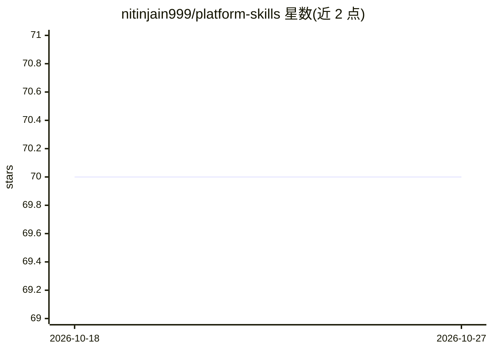

# nitinjain999/platform-skills

⭐ 70 · Shell · Apache-2.0 · 推送 2026-10-26 · [GitHub](https://github.com/nitinjain999/platform-skills) · 个人维护

**面向平台/DevOps/SRE 工程师的运维领域参考手册与 AI 插件层**

覆盖 Kubernetes、Kyverno、OpenShift、Argo CD、Flux CD、AWS/Azure、Terraform、GitHub Actions、可观测性等约 35 个领域的参考手册：references/ 目录提供深度指南，examples/ 提供可复制的示例资产。核心是知识库本身，各层（Claude 插件、Codex skill、Cursor rules、Copilot 指令）独立工作、agent 集成为可选：Claude Code 提供 51 个斜杠命令，Claude/Codex 通过 SKILL.md 路由到对应章节。安装方式为 git clone 后按所选工具运行安装脚本或插件命令。

## 筛选速览

| 维度 | 判定 | 备注 |
|---|---|---|
| AI 角色 | `ai-knowledge` | 知识聚合/清单类 |
| 许可风险 | `permissive` | Apache-2.0 |
| 部署形态 | `library` | 以包/库形式分发 |
| 模型依赖 | — | README 未给出锁定关系 |
| 硬件要求 | — | 无带数字的原话,不猜 |
| 安装摩擦 | `low` | 无编译、无系统依赖或容器化 |
| 成熟度 | — | 结构信号不足 |

## 能力要点

- references/ 与 examples/ 构成的独立领域参考手册（K8s/GitOps/云/安全等）
- Claude Code 插件层提供 51 个斜杠命令与自动激活
- Codex skill、Cursor rules、Copilot instructions 等多种可选集成层，可独立使用

## 适用场景

- 合并前让 AI 按 handbook 审查 Terraform/K8s/GitHub Actions 变更
- 团队将平台工程基线以 Copilot 指令形式提交到仓库共享
- 直接浏览 references/ 作为平台工程速查手册

## 场景标签

`知识库管理` · 领域:知识与检索

## 证据(README 行号)

> L3: > A production-grade field handbook for platform, DevOps, SRE, and cloud engineers covering Kubernetes, Flux CD, Ter
> L82: This repository is a reference handbook for developers, DevOps engineers, SREs, cloud engineers, and platform teams
> L90: All layers work independently. Agent integrations are optional.

## 星数曲线

2026-10-18 70 → 2026-10-27 70（+0）

---
*卡片 v1 · prompt 1.4 · 生成 2026-10-24 · 置信度 high · 依据 README sha `1d4d02ed994f` · [字段定义](../../DATASET.md)*
