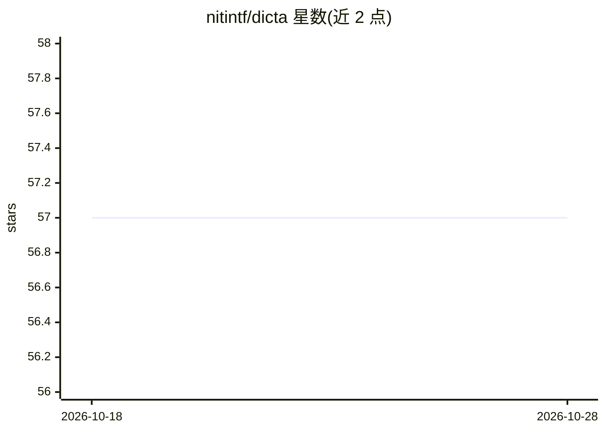

# nitintf/dicta

⭐ 57 · TypeScript · MIT · 推送 2026-06-12 · [GitHub](https://github.com/nitintf/dicta) · [官网](https://dicta.nitin.sh) · 个人维护

**macOS 菜单栏语音转文字应用：快捷键说话即得文本**

基于 Tauri（React/Rust）的原生 macOS 语音转录应用，常驻菜单栏，通过全局快捷键唤起悬浮输入窗口，转录结果自动复制到剪贴板或直接粘贴到当前应用。支持 6 种转录引擎：云端（OpenAI Whisper、Google Speech-to-Text、AssemblyAI、ElevenLabs，需 API key）与本地（whisper.cpp、Apple Speech）。另提供 AI 驱动的文本风格转换（专业/随意/邮件）与转录历史搜索。通过 .dmg 安装包或源码构建安装。

## 筛选速览

| 维度 | 判定 | 备注 |
|---|---|---|
| AI 角色 | `ai-native` | 本体是模型或模型工具 |
| 许可风险 | `permissive` | MIT |
| 部署形态 | `desktop` | 安装包/桌面程序 |
| 模型依赖 | — | README 未给出锁定关系 |
| 硬件要求 | — | 无带数字的原话,不猜 |
| 安装摩擦 | `low` | 无编译、无系统依赖或容器化 |
| 成熟度 | — | 结构信号不足 |

## 能力要点

- 6 种转录引擎（4 云端 + 本地 whisper.cpp 与 Apple Speech）
- 全局快捷键唤起，结果自动复制或直接粘贴
- AI 文本风格转换（professional/casual/email/自定义）
- 本地处理选项与转录历史搜索

## 适用场景

- 在任意应用中用语音快速输入文字
- 选择本地引擎做隐私优先的语音转录
- 把口述内容自动整理成邮件或正式文本

## 场景标签

`语音识别` `AI 写作` · 领域:内容生成

## 证据(README 行号)

> L5: Voice-to-text for macOS. Press a shortcut, speak, and your words appear as text.
> L15: Dicta is a native macOS app that transcribes your voice to text. It sits in your menu bar, ready to capture your th
> L59: |Provider|Type|Notes|

## 星数曲线

2026-10-18 57 → 2026-10-28 57（+0）

---
*卡片 v1 · prompt 1.4 · 生成 2026-10-24 · 置信度 mid · 依据 README sha `c8ab5573a386` · [字段定义](../../DATASET.md)*
