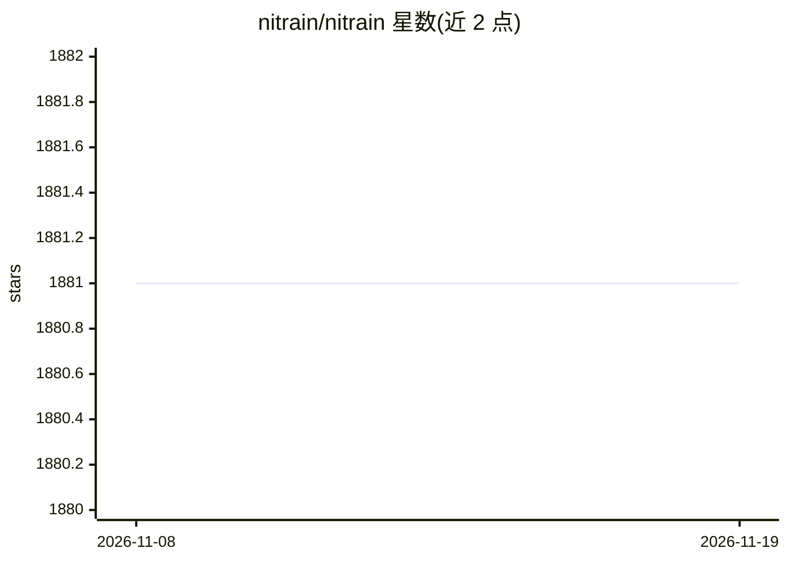

# nitrain/nitrain

⭐ 1,881 · Python · AGPL-3.0 · 推送 2026-11-06 · [GitHub](https://github.com/nitrain/nitrain) · 组织维护

**医学影像 AI 训练框架：采样、增强、训练、可视化**

框架无关的 Python 库（前身为 torchsample），用于医学影像的采样与增强、在医学影像数据集上训练模型并做可视化。通过合理默认值与高层抽象简化训练流程，支持 torch、tensorflow、keras 三种后端，目标增加更多框架。关键依赖 ants 包用于读取、操作与可视化医学影像。提供教程与分割、分类、配准示例。

## 筛选速览

| 维度 | 判定 | 备注 |
|---|---|---|
| AI 角色 | `ai-ecosystem` | LLM/agent 周边工具 |
| 许可风险 | `viral` | AGPL-3.0 |
| 部署形态 | `library` | 以包/库形式分发 |
| 模型依赖 | — | README 未给出锁定关系 |
| 硬件要求 | — | 无带数字的原话,不猜 |
| 安装摩擦 | `low` | 无编译、无系统依赖或容器化 |
| 成熟度 | — | 结构信号不足 |

## 能力要点

- 框架无关设计，支持 torch/tensorflow/keras 后端
- 医学影像采样、增强、训练、可视化一体化
- 高层抽象与默认配置简化训练流程
- 核心依赖 ants 包处理医学影像读写

## 适用场景

- 在医学影像数据集上训练分割或分类模型
- 对医学影像做采样与数据增强
- 切换不同深度学习后端训练同一任务

## 场景标签

 · 领域:医学影像/深度学习

## 证据(README 行号)

> L6: Nitrain (formerly torchsample ) is a framework-agnostic python library for sampling and augmenting medical images, t
> L8: The nitrain library is unique in that it makes training models as simple as possible by providing reasonable default

## 星数曲线

2026-11-08 1,881 → 2026-11-19 1,881（+0）

---
*卡片 v1 · prompt 1.4 · 生成 2026-11-17 · 置信度 high · 依据 README sha `de0812757721` · [字段定义](../../DATASET.md)*
