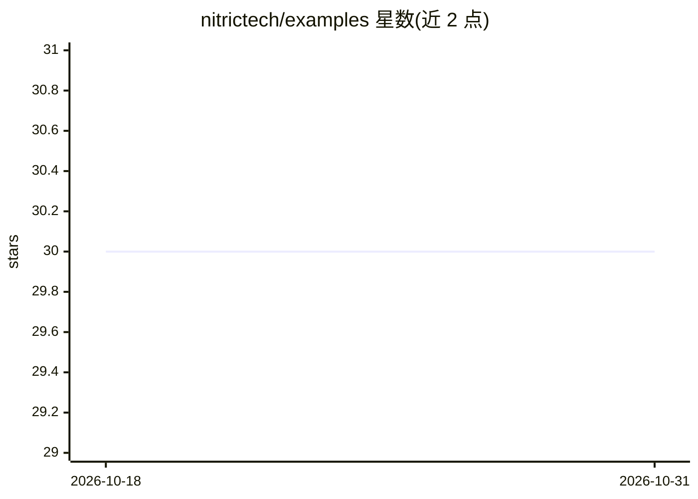

# nitrictech/examples

⭐ 30 · TypeScript · Apache-2.0 · 推送 2026-01-30 · [GitHub](https://github.com/nitrictech/examples) · [官网](https://nitric.io) · 组织维护

**Nitric 云原生框架的多语言示例与启动模板合集**

Nitric 官方示例仓库，收录 TypeScript/JavaScript、Python、Dart、Go 等语言的启动模板与示例项目，覆盖 REST API、存储、队列、定时任务、认证、WebSocket 等场景，其中少量示例涉及 AI（OpenAI embeddings 向量库、Whisper 转录、RAG）。所有示例可用 Nitric 部署到 AWS/GCP/Azure，或本地运行。各项目 setup 需参阅其各自 README，部分依赖云服务。

## 筛选速览

| 维度 | 判定 | 备注 |
|---|---|---|
| AI 角色 | `ai-ecosystem` | LLM/agent 周边工具 |
| 许可风险 | `permissive` | Apache-2.0 |
| 部署形态 | `None` |  |
| 模型依赖 | — | README 未给出锁定关系 |
| 硬件要求 | — | 无带数字的原话,不猜 |
| 安装摩擦 | `low` | 无编译、无系统依赖或容器化 |
| 成熟度 | — | 结构信号不足 |

## 能力要点

- 多语言启动模板与数十个示例项目
- 同一代码库可部署 AWS/GCP/Azure 或本地运行
- 含少量 AI 示例（OpenAI embeddings、Whisper 转录、RAG）

## 适用场景

- 用 nitric new 命令选择语言模板快速创建 Nitric 项目
- 查找特定场景（API、存储、认证、WebSocket）的 Nitric 实现参考
- 了解如何将同一代码部署到多云环境

## 场景标签

 · 领域:云计算/开发框架示例

## 证据(README 行号)

> L15: This repository serves as the Nitric Examples repository, housing both starter templates for the languages supporte
> L104: Nitric is a framework for rapid development of cloud-native and serverless applications in many languages.

## 星数曲线

2026-10-18 30 → 2026-10-31 30（+0）

---
*卡片 v1 · prompt 1.4 · 生成 2026-10-26 · 置信度 mid · 依据 README sha `0969c9c0e58d` · [字段定义](../../DATASET.md)*
