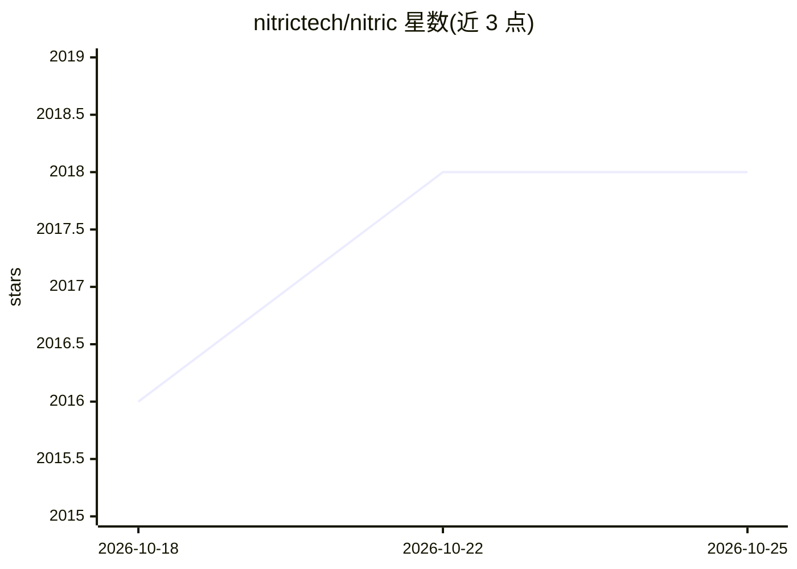

# nitrictech/nitric

⭐ 2,018 · Go · Apache-2.0 · 推送 2026-10-23 · [GitHub](https://github.com/nitrictech/nitric) · [官网](https://nitric.io) · 组织维护

**多语言云端应用框架：从代码推断并自动部署基础设施**

Nitric 是一个开源的多语言云应用框架，采用 infrastructure from code 方式：开发者只写应用代码，框架从中推断基础设施需求（API、存储桶、队列、数据库、KV 等），自动配置 IAM 权限并通过 Pulumi 或 Terraform 插件部署到 AWS、GCP、Azure 等云。应用与云厂商及 IaC 工具解耦，支持本地运行与自定义 provider 插件。提供 brew/curl/scoop 三平台 CLI 安装。README 中未出现 AI 相关功能描述（仅仓库主题标签含 ai）。

## 筛选速览

| 维度 | 判定 | 备注 |
|---|---|---|
| AI 角色 | `ai-ecosystem` | LLM/agent 周边工具 |
| 许可风险 | `permissive` | Apache-2.0 |
| 部署形态 | `None` |  |
| 模型依赖 | — | README 未给出锁定关系 |
| 硬件要求 | — | 无带数字的原话,不猜 |
| 安装摩擦 | `low` | 无编译、无系统依赖或容器化 |
| 成熟度 | — | 结构信号不足 |

## 能力要点

- 从应用代码推断基础设施需求，免手写 Terraform/Pulumi
- 支持 AWS、GCP、Azure 等多云部署，更换云厂商无需改代码
- 自动生成并配置 IAM 权限等安全策略
- 插件化部署架构，可自写部署插件

## 适用场景

- 用不到 10 行代码部署带 API 与存储桶的生产服务
- 让同一份应用代码在 AWS/GCP/Azure 间迁移
- 免去手写 IaC 模板与权限配置的云后端开发

## 场景标签

 · 领域:云原生/后端基础设施

## 证据(README 行号)

> L13: Nitric is a multi-language framework, with concise inline infrastructure from code. Modern applications should be r
> L83: All you need to do is write your application code and your infrastructure requirements are inferred. Nitric then or

## 星数曲线

2026-10-18 2,016 → 2026-10-25 2,018（+2）

---
*卡片 v1 · prompt 1.4 · 生成 2026-10-21 · 置信度 mid · 依据 README sha `ef3bda5a42aa` · [字段定义](../../DATASET.md)*
