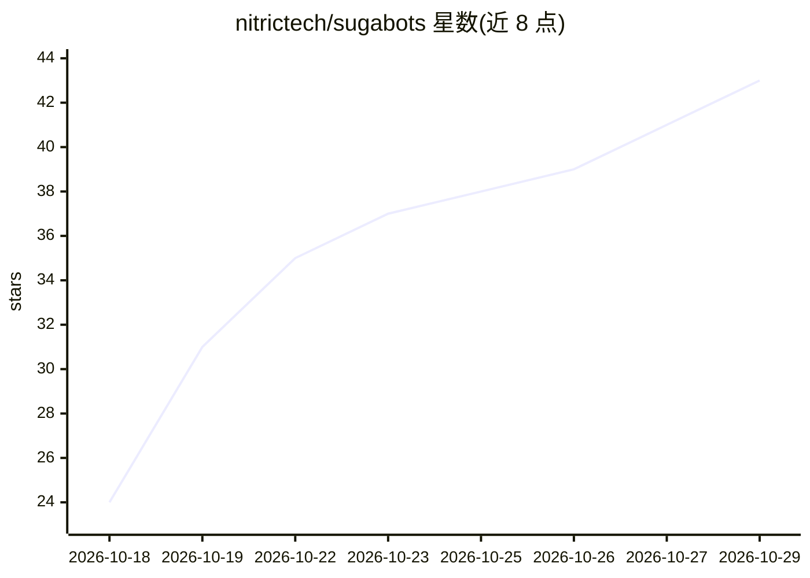

# nitrictech/sugabots

⭐ 43 · TypeScript · MIT · 推送 2026-10-28 · [GitHub](https://github.com/nitrictech/sugabots) · [官网](https://sugabots.ai) · 组织维护

**人与 AI agent 协同工作的自托管工作区平台**

由 React Web 应用、Hono API 与 PostgreSQL 组成的自托管工作区：用户创建 AI agent、将其组织进共享 pod，运行可调用内置工具与 MCP 连接的对话。账号、会话、配置与加密的 provider 凭据保存在自有数据库中；模型请求仅发往用户配置的提供商（如 Anthropic、OpenAI 或自网络内 OpenAI/Anthropic 兼容的模型服务）。本地开发需 Node.js 26+、Bun 与 Docker Compose 运行 PostgreSQL；也提供单镜像 Docker 部署方式。

## 筛选速览

| 维度 | 判定 | 备注 |
|---|---|---|
| AI 角色 | `ai-native` | 本体是模型或模型工具 |
| 许可风险 | `permissive` | MIT |
| 部署形态 | `self-host` | docker 或自建部署 |
| 模型依赖 | — | README 未给出锁定关系 |
| 硬件要求 | — | 无带数字的原话,不猜 |
| 安装摩擦 | `low` | 无编译、无系统依赖或容器化 |
| 成熟度 | — | 结构信号不足 |

## 能力要点

- 创建 agent 并组织进共享 pod 进行协作
- 支持内置工具与 MCP 连接的对话运行
- 凭据加密存储于自有 PostgreSQL，模型请求仅发往用户配置的 provider
- 提供单镜像 Docker 部署（Railway/Render 等平台可构建）

## 适用场景

- 在自有服务器上搭建人与 AI agent 协作的工作区
- 通过 MCP 连接让 agent 使用外部工具
- 团队以 pod 形式共享管理多个 agent

## 场景标签

`多智能体` · 领域:Agent 开发

## 证据(README 行号)

> L3: Sugabots is a self-hosted workspace where people and AI agents work together.
> L4: Create agents, organise them into shared pods, and run conversations that can use
> L5: built-in tools and MCP connections.

## 星数曲线

2026-10-18 24 → 2026-10-29 43（+19）

---
*卡片 v1 · prompt 1.4 · 生成 2026-10-25 · 置信度 high · 依据 README sha `50cd3a546d57` · [字段定义](../../DATASET.md)*
