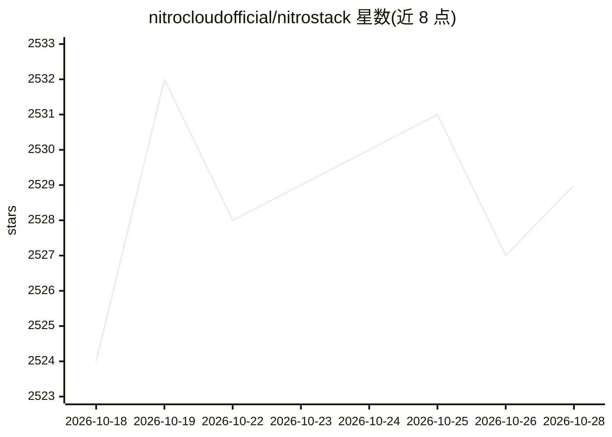

# nitrocloudofficial/nitrostack

⭐ 2,527 · TypeScript · Apache-2.0 · 推送 2026-10-19 · [GitHub](https://github.com/nitrocloudofficial/nitrostack) · [官网](https://nitrostack.ai) · 组织维护

**TypeScript 全栈框架：构建、测试、部署生产级 MCP 服务器**

面向 MCP 服务器与 AI-native 应用的 TypeScript 框架：以装饰器声明工具/资源/提示词，内置依赖注入容器（singleton/transient/scoped 生命周期）、JWT/OAuth 2.1/API key 认证、中间件管道（guards/interceptors/pipes/exception filters）、Zod 端到端校验，并支持在工具输出上挂载 React UI Widgets。生态含 CLI 脚手架、React Widgets SDK，以及用于可视化测试与调试的 NitroStudio 桌面应用（含实时工具测试、AI 聊天、热重载）。要求 Node.js ≥ 20.18、npm ≥ 9。

## 筛选速览

| 维度 | 判定 | 备注 |
|---|---|---|
| AI 角色 | `ai-ecosystem` | LLM/agent 周边工具 |
| 许可风险 | `permissive` | Apache-2.0 |
| 部署形态 | `library` | 以包/库形式分发 |
| 模型依赖 | — | README 未给出锁定关系 |
| 硬件要求 | — | 无带数字的原话,不猜 |
| 安装摩擦 | `low` | 无编译、无系统依赖或容器化 |
| 成熟度 | — | 结构信号不足 |

## 能力要点

- 装饰器声明式定义 tools/resources/prompts
- 内置 DI 容器与 JWT/OAuth 2.1/API key 认证
- 工具输出可挂载 React UI Widgets
- NitroStudio 桌面应用提供可视化测试、调试与 AI 聊天

## 适用场景

- 用 TypeScript 快速搭建生产级 MCP 服务器
- 为 MCP 服务器做可视化工具测试与调试
- 构建带认证与校验的 AI-native 后端

## 场景标签

`Agent 框架` · 领域:Agent 开发

## 证据(README 行号)

> L7:  The enterprise-grade TypeScript framework for building production-ready MCP servers.
> L51: Your MCP server is running. Connect it to any MCP-compatible client.

## 星数曲线

2026-10-18 2,524 → 2026-10-28 2,529（+5）

---
*卡片 v1 · prompt 1.4 · 生成 2026-10-21 · 置信度 high · 依据 README sha `d93bf9d3f0f5` · [字段定义](../../DATASET.md)*
