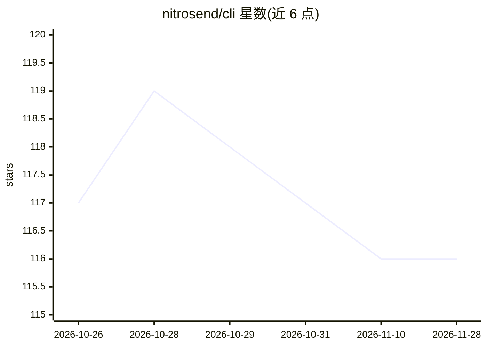

# nitrosend/cli

⭐ 116 · TypeScript · MIT · 推送 2026-11-23 · [GitHub](https://github.com/nitrosend/cli) · [官网](https://www.npmjs.com/package/@nitrosend/cli) · 组织维护

**Nitrosend 邮件/短信营销平台的终端 CLI，可调用其 MCP 工具**

Nitrosend 营销服务的命令行客户端：起草与发送 campaign、单发邮件/SMS、管理 flows、查询联系人、导入 HubSpot/Mailchimp/Klaviyo 联系人、操作 Agent Inbox。所有命令调用 Nitrosend 的 MCP 端点，AI agent 可用的工具 CLI 用户同样可用。支持 OAuth 与 API key 双认证、多 profile、统一 JSON 输出信封、幂等键重试、dry-run 预览与结构化退出码，适用于终端与 CI 场景。需要 Node.js 18+。

## 筛选速览

| 维度 | 判定 | 备注 |
|---|---|---|
| AI 角色 | `ai-enhanced` | 去掉 AI 部分产品仍成立 |
| 许可风险 | `permissive` | MIT |
| 部署形态 | `library` | 以包/库形式分发 |
| 模型依赖 | — | README 未给出锁定关系 |
| 硬件要求 | — | 无带数字的原话,不猜 |
| 安装摩擦 | `low` | 无编译、无系统依赖或容器化 |
| 成熟度 | — | 结构信号不足 |

## 能力要点

- 暴露完整 Nitrosend MCP 表面：工具、资源、prompts 均可从终端调用
- OAuth 浏览器登录与 API key/环境变量认证，支持无浏览器 signup 流程
- 统一 JSON 输出信封、幂等键、dry-run 与 8 类退出码，面向脚本与 CI
- 支持从 Mailchimp/Klaviyo/HubSpot 迁移联系人

## 适用场景

- 在 CI 管道中用 API key 自动发送邮件和运行 flows
- 从 Mailchimp/Klaviyo 迁移联系人到 Nitrosend
- 让 AI agent 通过 MCP 工具操作营销账户，CLI 侧做校验与重放

## 场景标签

 · 领域:营销自动化/开发者工具

## 证据(README 行号)

> L3: The Nitrosend command-line interface. Draft campaigns, send tests, run flows, query contacts, and inspect account st
> L91: The CLI exposes the full Nitrosend MCP surface — every tool an AI agent can call, you can call too:
> L253: `@nitrosend/cli` is the user-facing CLI. If you're integrating Nitrosend into an MCP-aware AI host (Claude Desktop

## 星数曲线

2026-10-26 117 → 2026-11-28 116（-1）

---
*卡片 v1 · prompt 1.4 · 生成 2026-11-28 · 置信度 high · 依据 README sha `e19376d71066` · [字段定义](../../DATASET.md)*
