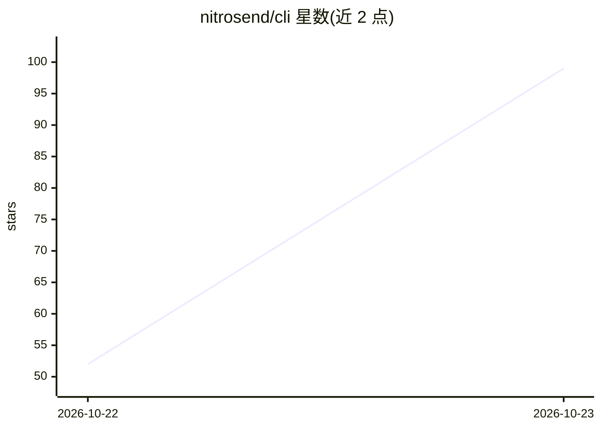

# nitrosend/cli

⭐ 99 · TypeScript · MIT · 推送 2026-10-21 · [GitHub](https://github.com/nitrosend/cli) · [官网](https://www.npmjs.com/package/@nitrosend/cli) · 组织维护

**Nitrosend 营销平台的命令行客户端：终端发送邮件短信、跑流程、调 MCP 工具**

Nitrosend（邮件/短信营销自动化服务）的官方 CLI：从终端或 CI 管道起草营销活动、发送测试、运行 flows、查询联系人、检查账户状态，并可直接列出与调用 Nitrosend 的全部 MCP 工具、资源和 prompts。认证支持浏览器 OAuth 与 API key（CI/无头环境），多账户 profile，输出统一 JSON envelope 与结构化错误码。所有付费档位（含免费）均可访问 MCP/API/CLI，限制仅在用量。需 Node.js 18+。

## 筛选速览

| 维度 | 判定 | 备注 |
|---|---|---|
| AI 角色 | `ai-ecosystem` | LLM/agent 周边工具 |
| 许可风险 | `permissive` | MIT |
| 部署形态 | `library` | 以包/库形式分发 |
| 模型依赖 | — | README 未给出锁定关系 |
| 硬件要求 | — | 无带数字的原话,不猜 |
| 安装摩擦 | `low` | 无编译、无系统依赖或容器化 |
| 成熟度 | — | 结构信号不足 |

## 能力要点

- 通过 nitrosend mcp tools call 直接调用全部 Nitrosend MCP 工具
- 幂等键（--idempotency-key）保证重试不重复发送
- 统一 --json envelope、结构化错误与退出码约定
- 浏览器 OAuth、环境变量 API key、多 profile 三种认证方式

## 适用场景

- 在终端或 CI 中发送测试邮件、管理营销活动与联系人
- AI agent 通过 MCP 工具集操控 Nitrosend 营销功能
- 用 CLI 脚本化运行营销 flows 并以 JSON 输出对接管道

## 场景标签

`工作流自动化` · 领域:效率与自动化

## 证据(README 行号)

> L3: The Nitrosend command-line interface. Draft campaigns, send tests, run flows, query contacts, and inspect account st
> L67: The CLI exposes the full Nitrosend MCP surface — every tool an AI agent can call, you can call too:
> L215: `@nitrosend/cli` is the user-facing CLI. If you're integrating Nitrosend into an MCP-aware AI host (Claude Desktop

## 星数曲线

2026-10-22 52 → 2026-10-23 99（+47）

---
*卡片 v1 · prompt 1.4 · 生成 2026-10-23 · 置信度 high · 依据 README sha `c9614e1c8872` · [字段定义](../../DATASET.md)*
