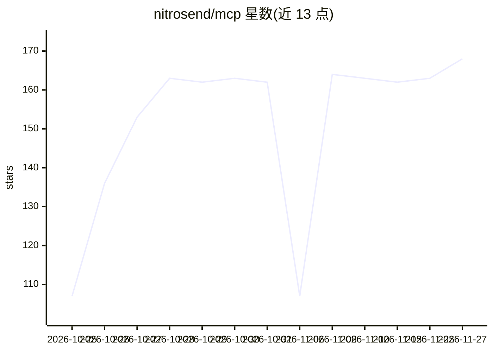

# nitrosend/mcp

⭐ 168 · JavaScript · MIT · 推送 2026-11-25 · [GitHub](https://github.com/nitrosend/mcp) · [官网](https://nitrosend.com) · 组织维护

**为 MCP 客户端桥接 Nitrosend 邮件营销远程服务**

Nitrosend 是面向 AI agent 的邮件营销平台，本仓库提供其远程 MCP 服务器（Streamable HTTP + OAuth 2.1）的接入说明，并附带 @nitrosend/mcp stdio 桥接包，供不支持 HTTP 传输的客户端通过 API key 连接。agent 可据此撰写发送新闻通讯、营销活动与自动化邮件流、发送事务性邮件、管理联系人列表与分段、验证发信域名并读取营销分析数据。配置覆盖 Claude、Cursor、VS Code、Windsurf、Codex、Zed 等客户端，另提供 Claude Desktop 一键扩展（.mcpb）。发送需显式批准步骤，支持 Safe Mode；免费计划可用。

## 筛选速览

| 维度 | 判定 | 备注 |
|---|---|---|
| AI 角色 | `ai-ecosystem` | LLM/agent 周边工具 |
| 许可风险 | `permissive` | MIT |
| 部署形态 | `None` |  |
| 模型依赖 | — | README 未给出锁定关系 |
| 硬件要求 | — | 无带数字的原话,不猜 |
| 安装摩擦 | `low` | 无编译、无系统依赖或容器化 |
| 成熟度 | — | 结构信号不足 |

## 能力要点

- stdio 桥接包 @nitrosend/mcp，供仅支持 stdio 的 MCP 客户端使用
- 远程 MCP 服务器支持 OAuth 2.1 登录，无需 API key
- 覆盖 20+ 工具：活动撰写、自动化流程、事务邮件、联系人管理、域名验证与分析
- 提供 Claude Desktop 一键扩展（.mcpb）与多客户端配置示例

## 适用场景

- 让 Claude 或 Cursor 里的 agent 代我撰写并定时发送新闻通讯
- 通过对话搭建弃购提醒、欢迎系列等自动化邮件流
- 把 Mailchimp/Klaviyo 等平台的订阅名单迁移过来
- 从应用里通过 REST API/Node SDK 发送订单确认等事务性邮件

## 场景标签

`工作流自动化` · 领域:效率与自动化

## 证据(README 行号)

> L1: # Nitrosend MCP Server: email marketing for AI agents
> L9: This repository also ships `@nitrosend/mcp`, an optional stdio bridge for clients that cannot connect to a remote se
> L5: - **Remote MCP server:** `https://api.nitrosend.com/mcp` (Streamable HTTP, OAuth 2.1 sign-in, no API key needed)

## 星数曲线

2026-10-25 107 → 2026-11-27 168（+61）

---
*卡片 v1 · prompt 1.4 · 生成 2026-11-27 · 置信度 high · 依据 README sha `1b5a60222c19` · [字段定义](../../DATASET.md)*
