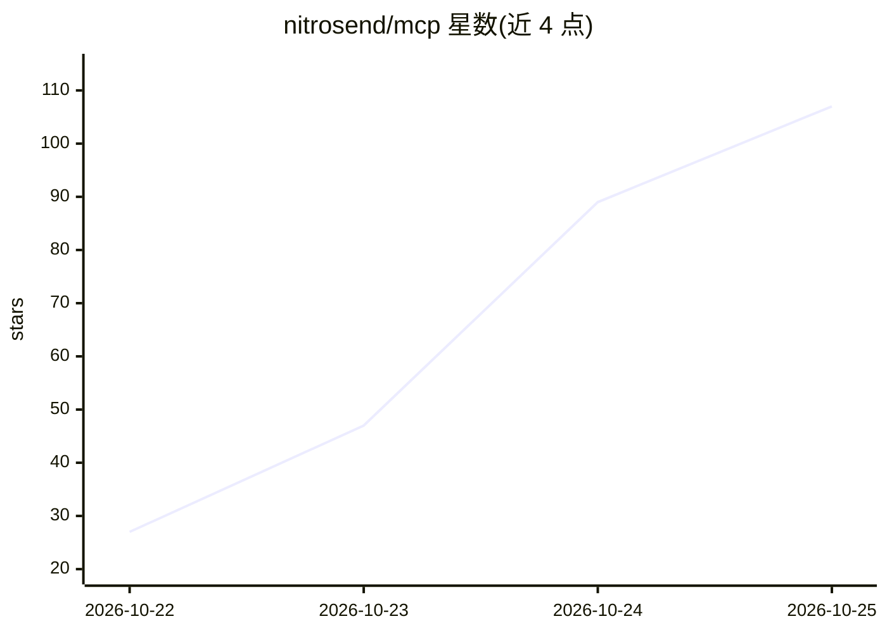

# nitrosend/mcp

⭐ 136 · JavaScript · MIT · 推送 2026-10-25 · [GitHub](https://github.com/nitrosend/mcp) · [官网](https://nitrosend.com) · 组织维护

**Nitrosend 远程 MCP 服务器的 stdio 桥接包：让仅支持 stdio 的客户端接入**

Nitrosend 是电子邮件营销/营销自动化产品，提供远程 MCP 服务器（api.nitrosend.com/mcp），让 AI agent 用自然语言查询联系人、撰写邮件、构建自动化流程、发送与审批营销活动、查看打开/点击等指标。本包是可选的 stdio 桥接层：多数支持 HTTP/OAuth 的客户端应直连远程服务器；仅支持 stdio 的客户端通过本包以 API key 接入，可用环境变量固定品牌（X-Brand-SID）。README 同时给出 Claude Code、Cursor、VS Code、Windsurf、Codex CLI、Zed 等客户端的接入配置。要求 Node.js 18+，MIT 许可。

## 筛选速览

| 维度 | 判定 | 备注 |
|---|---|---|
| AI 角色 | `ai-ecosystem` | LLM/agent 周边工具 |
| 许可风险 | `permissive` | MIT |
| 部署形态 | `None` |  |
| 模型依赖 | — | README 未给出锁定关系 |
| 硬件要求 | — | 无带数字的原话,不猜 |
| 安装摩擦 | `low` | 无编译、无系统依赖或容器化 |
| 成熟度 | — | 结构信号不足 |

## 能力要点

- 远程 MCP 服务器支持 OAuth 浏览器登录，无需 API key
- stdio 桥接层面向仅支持 stdio 的客户端，使用 API key
- agent 可查询联系人/分组/流程/活动并发送邮件、运行垃圾邮件检查
- 多账户与品牌切换（nitro_select_account / nitro_select_brand），stdio 部署可固定品牌

## 适用场景

- 用 AI agent 管理邮件联系人、分组与标签
- 通过对话撰写邮件、构建自动化流程并安排营销活动
- 在仅支持 stdio 传输的 MCP 客户端中接入 Nitrosend

## 场景标签

 · 领域:营销自动化/邮件营销

## 证据(README 行号)

> L3: Optional stdio bridge for Nitrosend. Most clients should connect directly to Nitrosend's remote MCP server at `https
> L134: **If your client only supports stdio**, use this bridge package with an API key:

## 星数曲线

2026-10-22 27 → 2026-10-25 107（+80）

---
*卡片 v1 · prompt 1.4 · 生成 2026-10-23 · 置信度 high · 依据 README sha `ee97c6e9dadd` · [字段定义](../../DATASET.md)*
