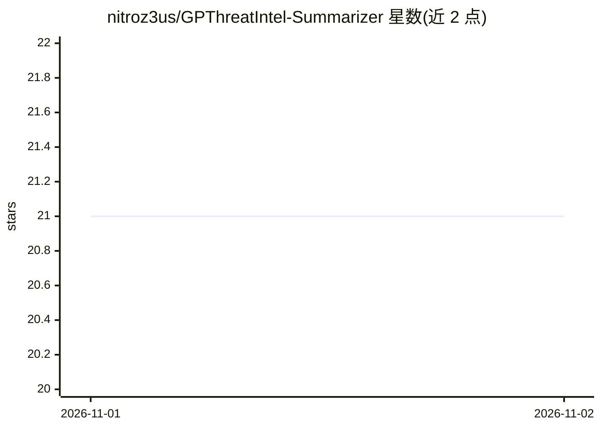

# nitroz3us/GPThreatIntel-Summarizer

⭐ 21 · HTML · 推送 2026-10-31 · [GitHub](https://github.com/nitroz3us/GPThreatIntel-Summarizer) · [官网](https://gp-threat-intel-summarizer.vercel.app/) · 个人维护

**用 OpenAI GPT 自动摘要网络威胁情报（CTI）报告的工具**

Python 编写的 CTI 报告摘要工具：通过 BeautifulSoup 与 pdfplumber 从报告网页或 PDF 中抽取文本，调用 OpenAI GPT 模型生成按用户指定长度的摘要，并提取 IOC 与 TTP 展示；提供 FastAPI 驱动的 Web 界面，可本地运行或访问在线部署版本，使用需自行提供 OpenAI API Key。README 注明该项目为 2023 年的早期实验，默认模型 GPT-3.5 Turbo 约 4,000 token 上下文，长报告需换更大上下文模型。

## 筛选速览

| 维度 | 判定 | 备注 |
|---|---|---|
| AI 角色 | `ai-native` | 本体是模型或模型工具 |
| 许可风险 | `none` | — |
| 部署形态 | `library` | 以包/库形式分发 |
| 模型依赖 | — | README 未给出锁定关系 |
| 硬件要求 | — | 无带数字的原话,不猜 |
| 安装摩擦 | `low` | 无编译、无系统依赖或容器化 |
| 成熟度 | `idea` | |

## 能力要点

- 从 CTI 报告网页或 PDF 抽取文本并生成摘要
- 提取 IOC（失陷指标）与 TTP（战术、技术与程序）
- FastAPI Web 界面，支持在线部署版本
- 摘要长度可按用户指定字数控制

## 适用场景

- 威胁分析师快速生成 CTI 报告摘要供管理层阅读
- 从威胁报告中批量提取 IOC 与 TTP 指标
- 通过网页界面上传 PDF 报告并选择 GPT 模型生成摘要

## 场景标签

`网络安全` `AI 写作` · 领域:内容生成

## 证据(README 行号)

> L5: GPThreatIntel-Summarizer is a Python-based repository that leverages the power of OpenAI's GPT (Generative Pre-train
> L9: - Utilizes OpenAI GPT models for natural language processing and summarization tasks.

## 星数曲线

2026-11-01 21 → 2026-11-02 21（+0）

---
*卡片 v1 · prompt 1.4 · 生成 2026-10-31 · 置信度 mid · 依据 README sha `e27a997611da` · [字段定义](../../DATASET.md)*
