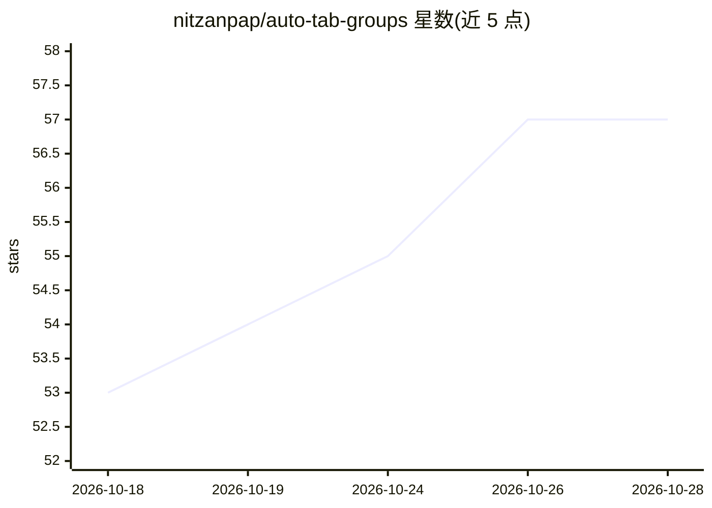

# nitzanpap/auto-tab-groups

⭐ 57 · TypeScript · GPL-3.0 · 推送 2026-09-22 · [GitHub](https://github.com/nitzanpap/auto-tab-groups) · [官网](https://addons.mozilla.org/en-US/firefox/addon/auto-tab-groups/) · 个人维护

**按域名/规则自动分组浏览器标签页的跨浏览器扩展，含端侧 AI 建议**

基于 WXT 与 TypeScript 的单一代码库扩展，同时支持 Chrome 与 Firefox（Manifest V3，Tab Groups API）。核心功能为按域名/子域名自动分组标签页，支持 ccSLD（如 co.uk）、IP/localhost 特殊处理，可创建将多域名合并为命名组的自定义规则并以 JSON 导入导出，另含组颜色管理、Focus Mode、侧边栏等。AI 部分通过 WebLLM/WebGPU 在设备端运行：分析打开的标签页给出主题分组建议、按自然语言描述生成规则，可选 6 个模型（360MB–3.8GB），要求具备 WebGPU 能力的浏览器与足够 VRAM 的 GPU。面向普通浏览器用户，从应用商店安装，开发者可用 bun 构建。

## 筛选速览

| 维度 | 判定 | 备注 |
|---|---|---|
| AI 角色 | `ai-enhanced` | 去掉 AI 部分产品仍成立 |
| 许可风险 | `viral` | GPL-3.0 |
| 部署形态 | `None` |  |
| 模型依赖 | — | README 未给出锁定关系 |
| 硬件要求 | — | 无带数字的原话,不猜 |
| 安装摩擦 | `low` | 无编译、无系统依赖或容器化 |
| 成熟度 | — | 结构信号不足 |

## 能力要点

- 单一代码库同时支持 Chrome 与 Firefox（Manifest V3，Tab Groups API）
- 按域名/子域名自动分组，支持 ccSLD、IP、localhost 等特殊处理
- 自定义规则将多域名合并为命名组，支持 JSON 导出导入
- WebLLM/WebGPU 端侧 AI：主题分组建议与自然语言规则生成，6 个可选模型

## 适用场景

- 自动整理大量打开的标签页，按网站域名归类
- 把常用的多个网站（如社交、通讯、开发工具站）合并成自定义组
- 用自然语言描述让 AI 生成分组规则或获得主题分组建议

## 场景标签

 · 领域:浏览器效率工具

## 证据(README 行号)

> L5: A lightweight cross-browser extension that automatically groups open tabs by domain, with intelligent domain name ha
> L37: - ✅ **AI-powered features** - On-device AI via WebLLM (privacy-first, no data leaves your browser)
> L90: ### 🤖 AI-Powered Features (On-Device, Privacy-First)

## 星数曲线

2026-10-18 53 → 2026-10-28 57（+4）

---
*卡片 v1 · prompt 1.4 · 生成 2026-10-24 · 置信度 high · 依据 README sha `3413148aaf65` · [字段定义](../../DATASET.md)*
