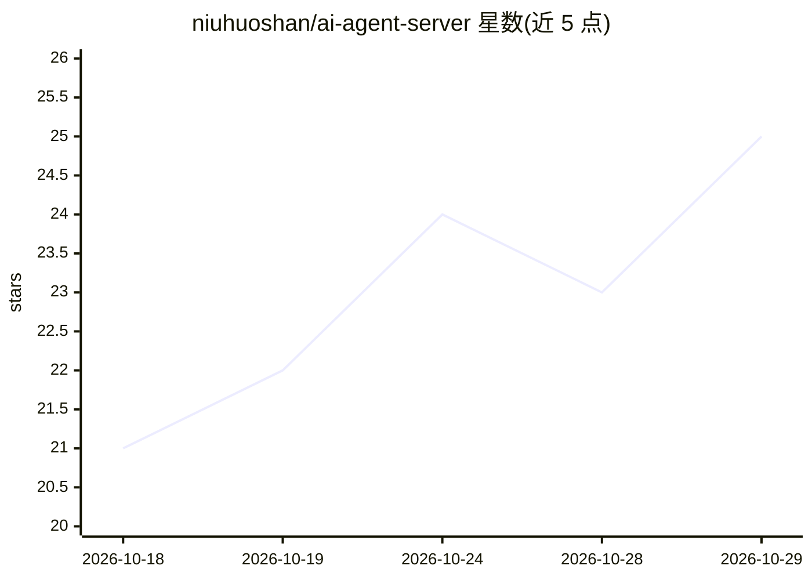

# niuhuoshan/ai-agent-server

⭐ 25 · Java · 推送 2026-08-27 · [GitHub](https://github.com/niuhuoshan/ai-agent-server) · 个人维护 · 中文 README

**企业级通用智能体平台工程实践：多 Agent 协作与治理（Java 21）**

基于 Java 21、AgentScope Java、RuoYi-Vue-Plus 与 SoybeanAdmin 构建的企业私有化智能体平台原型，按用户客户端、配置管理端、治理运营端三个工作面划分。控制面管理 Agent、模型、Skill、MCP、知识与数据源的声明式配置与版本化发布；运行时承载多 Agent 协作与事件流；执行面通过 Browser Worker（Node/Playwright）与 Sandbox Runner 提供隔离执行；治理面覆盖权限、审批、风控、审计与 Token 计量。数据层用 PostgreSQL 16+/pgvector，迁移已至 V99。README 自述为项目快照，未经生产验收，后续计划以 Python 项目形态重构，本仓库保留为参考。

## 筛选速览

| 维度 | 判定 | 备注 |
|---|---|---|
| AI 角色 | `ai-ecosystem` | LLM/agent 周边工具 |
| 许可风险 | `none` | — |
| 部署形态 | `None` |  |
| 模型依赖 | — | README 未给出锁定关系 |
| 硬件要求 | — | 无带数字的原话,不猜 |
| 安装摩擦 | `medium` | 含编译或系统依赖之一 |
| 成熟度 | `idea` | |

## 能力要点

- 控制面/运行时/执行面/治理面四层架构，任务-执行-制品-验收业务闭环
- AgentScope 通过 SPI 适配接入，Browser 与 Sandbox 隔离执行不可信代码
- 权限包/审批/风控/审计/Token 用量分析的治理体系
- 98 个 PostgreSQL 迁移脚本，配置发布形成冻结快照支持审计回放

## 适用场景

- 企业私有化部署多 Agent 协作与数字员工平台
- 作为智能体平台续建、拆分或重构的工程参考
- 将已发布 Agent 通过 API/Embed 嵌入外部业务系统

## 场景标签

`多智能体` `Agent 框架` · 领域:Agent 开发

## 证据(README 行号)

> L5: 牛火山企业智能体平台（内部代号：`nhs`）是基于 Java 21 与 AgentScope Java 构建的企业级通用智能体平台工程实践，围绕任务驱动、数字员工、工作空间与业务接入四个核心域，将系统划分为控制面、运行时、执行面与治
> L233: - 项目已抽取 `nhs-runtime-spi`，AgentScope 通过适配模块接入，为未来增加运行引擎提供依赖边界；当前仍存在 AgentScope 专属语义和恢复协议，替换能力尚未验证。

## 星数曲线

2026-10-18 21 → 2026-10-29 25（+4）

---
*卡片 v1 · prompt 1.4 · 生成 2026-10-27 · 置信度 high · 依据 README sha `9230a4ce1bbb` · [字段定义](../../DATASET.md)*
