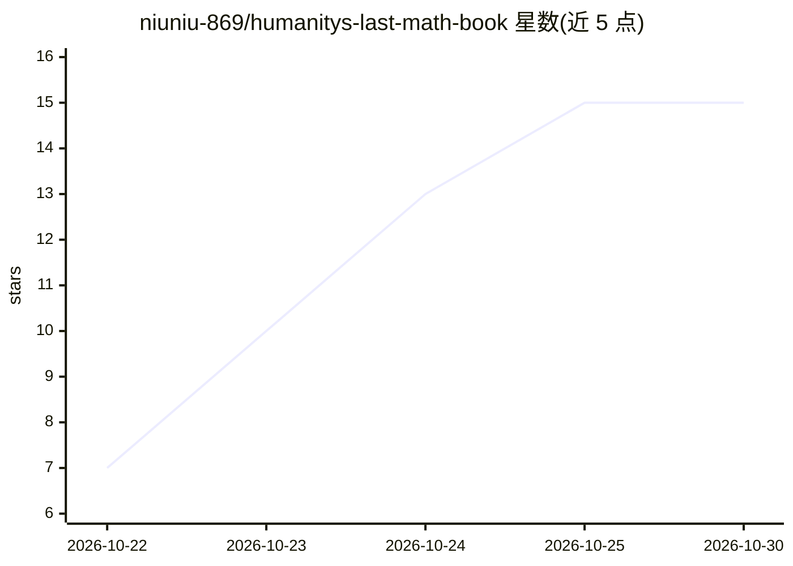

# niuniu-869/humanitys-last-math-book

⭐ 15 · Python · CC-BY-SA-4.0 · 推送 2026-10-20 · [GitHub](https://github.com/niuniu-869/humanitys-last-math-book) · 个人维护 · 中文 README

**从中学数学讲到读懂大模型的开源自学教材（11 册 97 章）**

面向自学者的非商业公益数理基础教材：6 部分、11 册、97 章、2431 页 PDF，含 1457 道题目，从逻辑证明讲到微积分、线性代数、概率统计，再到反向传播、注意力、RLHF 与扩散模型。全书内容由 Claude 与 Codex 起草生成，经代码验算（5096 项数值答案 0 失败）、数学审查与试读后开源；读者通过 Issue 提交勘误或卡点，触发 AI 重写、验算、人工审核的迭代流程。附带运行在 DeepSeek Harness（dsh）里的答疑插件，可按题号/页码检索并解答。

## 筛选速览

| 维度 | 判定 | 备注 |
|---|---|---|
| AI 角色 | `ai-knowledge` | 知识聚合/清单类 |
| 许可风险 | `viral` | CC-BY-SA-4.0 |
| 部署形态 | `library` | 以包/库形式分发 |
| 模型依赖 | — | README 未给出锁定关系 |
| 硬件要求 | — | 无带数字的原话,不猜 |
| 安装摩擦 | `low` | 无编译、无系统依赖或容器化 |
| 成熟度 | — | 结构信号不足 |

## 能力要点

- 97 章覆盖中学数学到大模型的数学基础，题目答案三档分级
- 5096 项数值答案经 sympy/numpy 脚本独立验算，0 项失败
- Issue→AI 起草→验算→人工审核→新版 PDF 的持续迭代机制
- 配套 dsh 答疑插件，支持 @题号/@页码 检索并画图、用 Python 演算

## 适用场景

- 自学补齐机器学习与大模型论文所需的数学基础
- 卡住时向配套答疑插件按题号或页码提问
- 通过提 Issue 报勘误或卡点参与教材迭代

## 场景标签

`教程课程` · 领域:学习与行业

## 证据(README 行号)

> L27: 它是一本给自学的人准备的数理基础教材。如果你学过中学数学，大学数学没学过，或者学过又忘得差不多了，现在想自学到能看懂机器学习和大模型论文里的公式，那这本书就是写给你的。它默认你没有老师，只能自己一页一页读，所以每个概念第一次被用到
> L29: 全书 6 个部分、11 册、97 章，PDF 一共 2431 页，题目 1457 道，讲义例题 1496 道。内容从「什么叫证明」讲起，经过微积分、线性代数、概率统计，最后落到反向传播、注意力、RLHF 和扩散模型，书里会让你亲手

## 星数曲线

2026-10-22 7 → 2026-10-30 15（+8）

---
*卡片 v1 · prompt 1.4 · 生成 2026-10-30 · 置信度 high · 依据 README sha `ab4fe72dedd5` · [字段定义](../../DATASET.md)*
