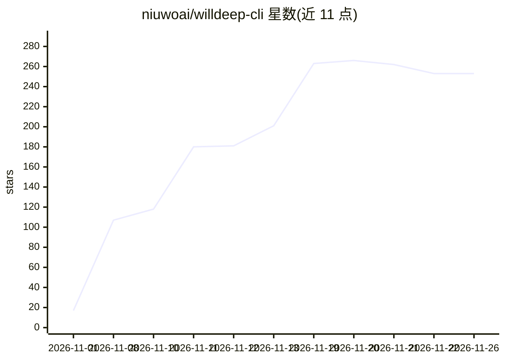

# niuwoai/willdeep-cli

⭐ 253 · Rust · NOASSERTION · 推送 2026-11-25 · [GitHub](https://github.com/niuwoai/willdeep-cli) · [官网](https://willdeep.com) · 个人维护 · 中文 README

**自托管多智能体编码 Agent，面向私有化部署的 Rust CLI**

以 Rust 编写的自托管编码 Agent：主控 Agent 协调、Worker 池分工，子 Agent 在专属 Git Worktree 干活，验证命令由 Runtime 亲自执行并以退出码裁决。Runtime 以常驻 Daemon 运行，终端 TUI、浏览器与手机三端共用同一 Session，客户端退出任务不中断。提供逐行改动归属、/rewind 检查点回退、五级命令审批闸门与审计报告导出。接 OpenAI 兼容与 Anthropic 线格式端点，可跑自有 GPU 上的开源权重。Web 模式为单用户、无应用层鉴权。

## 筛选速览

| 维度 | 判定 | 备注 |
|---|---|---|
| AI 角色 | `ai-ecosystem` | LLM/agent 周边工具 |
| 许可风险 | `none` | NOASSERTION |
| 部署形态 | `library` | 以包/库形式分发 |
| 模型依赖 | — | README 未给出锁定关系 |
| 硬件要求 | — | 无带数字的原话,不猜 |
| 安装摩擦 | `medium` | 含编译或系统依赖之一 |
| 成熟度 | — | 结构信号不足 |

## 能力要点

- 常驻 Runtime Daemon：关终端/断 SSH 后任务继续，按事件游标续接
- 逐行改动归属到 Agent 与工具调用，/rewind 回退对话与文件
- 子 Agent 验证由 Runtime 跑退出码裁决，靶场逐字比对测试块防作弊
- 工作区策略、静态规则、AI 判官、OS 围栏、用户 hooks 五道闸门

## 适用场景

- 数据不出机房，用自有 GPU 跑开源权重执行长任务编码
- 安全评审需要导出 Agent 审批与改动归属报告
- 小模型分工干活、主上下文留给长任务
- 终端发起任务，通勤时手机审批，回家浏览器看结果

## 场景标签

`编码 Agent` `多智能体` · 领域:Agent 开发

## 证据(README 行号)

> L78: - Runtime 以服务化方式在后台运行
> L95: willdeep --workspace . "检查当前仓库并修复测试"
> L212: - **自带模型，不锁厂商。** OpenAI Chat Completions、OpenAI Responses、Anthropic Messages 三种线格式，加上 some.im 一键登录。Provider 身份和线格式

## 星数曲线

2026-11-01 17 → 2026-11-26 253（+236）

---
*卡片 v1 · prompt 1.4 · 生成 2026-11-25 · 置信度 high · 依据 README sha `ee556294cc32` · [字段定义](../../DATASET.md)*
