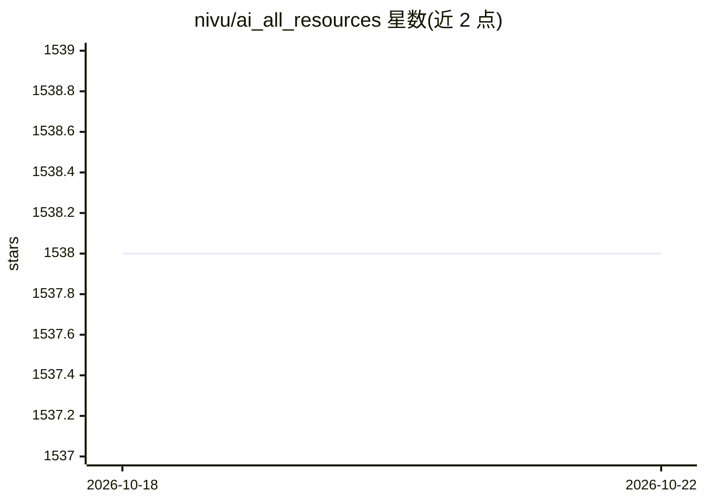

# nivu/ai_all_resources

⭐ 1,538 · Jupyter Notebook · 推送 2026-09-19 · [GitHub](https://github.com/nivu/ai_all_resources) · 个人维护

**面向学习者的数学/机器学习/深度学习资源教程策展清单**

由个人维护的 AI 学习资源聚合清单：收录 Karpathy、StatQuest、3Blue1Brown 等作者博客，Stanford/CMU/MIT/UCL 大学课程，MOOC，YouTube 播放列表，以及按算法主题（线性回归、决策树、SVM、K-Means、PCA、梯度下降、贝叶斯等）组织的教程链接。另覆盖 Python/NumPy/Pandas 与数学基础（线性代数、微积分）资源，部分条目为泰米尔语内容。清单纯链接目录，不提供代码或安装步骤，仅在末尾列出社区与维护者社交链接。

## 筛选速览

| 维度 | 判定 | 备注 |
|---|---|---|
| AI 角色 | `ai-knowledge` | 知识聚合/清单类 |
| 许可风险 | `none` | — |
| 部署形态 | `None` |  |
| 模型依赖 | — | README 未给出锁定关系 |
| 硬件要求 | — | 无带数字的原话,不猜 |
| 安装摩擦 | `low` | 无编译、无系统依赖或容器化 |
| 成熟度 | — | 结构信号不足 |

## 能力要点

- 收录 Stanford/CMU/MIT/UCL 等大学 20+ 门 AI/ML/DL/NLP/RL 课程
- 按算法主题（SVM/决策树/Boosting/K-Means/PCA 等）组织教程链接
- 覆盖数学基础（线性代数/微积分）、Python/NumPy/Pandas 与深度学习书籍论文

## 适用场景

- 按主题系统自学机器学习与深度学习
- 查找大学公开课程与 YouTube 讲解播放列表
- 补齐学习 ML 所需的数学和 Python/NumPy/Pandas 基础

## 场景标签

`教程课程` `精选清单` · 领域:学习与行业

## 证据(README 行号)

> L1: # An Ultimate Compilation of AI Resources for Mathematics, Machine Learning and Deep Learning
> L5: ### This collection is a compilation of Excellent ML and DL Tutorials created by the people below
> L71: ## Courses from Top Universities

## 星数曲线

2026-10-18 1,538 → 2026-10-22 1,538（+0）

---
*卡片 v1 · prompt 1.4 · 生成 2026-10-21 · 置信度 high · 依据 README sha `57c765fd6c48` · [字段定义](../../DATASET.md)*
