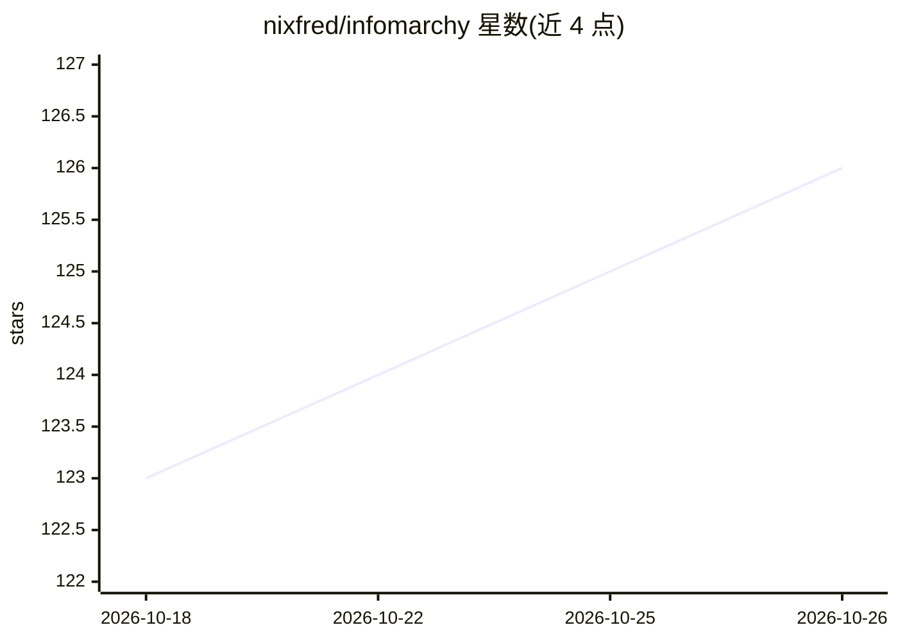

# nixfred/infomarchy

⭐ 126 · TypeScript · MIT · 推送 2026-10-25 · [GitHub](https://github.com/nixfred/infomarchy) · 个人维护

**把壁纸变成本机 AI agent 实时监控面板的 Omarchy 插件**

基于 Quickshell 的 Omarchy/Hyprland 桌面插件：把壁纸渲染为信息面板，直接从 /proc 检测本机运行的 AI agent（Claude Code、Codex、Cursor、Grok、Grok Bot、Gemini、Ollama 等），每会话一张卡片，显示项目、工作目录、运行时长、当前话题摘要（可由已加载的本地 Ollama 模型润色）、CPU/RAM/GPU 占用，并支持 7 天热力图、用量限额、最近任务与点击跳转到对应终端。僵尸会话标记 STALE，经二次确认可停止进程。面向在本机同时跑多个 AI agent 的 Linux 桌面用户。

## 筛选速览

| 维度 | 判定 | 备注 |
|---|---|---|
| AI 角色 | `ai-ecosystem` | LLM/agent 周边工具 |
| 许可风险 | `permissive` | MIT |
| 部署形态 | `None` |  |
| 模型依赖 | local-ok | 支持本地模型 |
| 硬件要求 | — | 无带数字的原话,不猜 |
| 安装摩擦 | `low` | 无编译、无系统依赖或容器化 |
| 成熟度 | — | 结构信号不足 |

## 能力要点

- 直接从 /proc 检测各 AI agent 会话，无需 agent 侧钩子
- 每会话卡片含项目、cwd、pid、话题摘要与 CPU/RAM/GPU 归属
- STALE 僵尸会话检测，STOP SESSION/END PROCESS 需四秒内二次确认
- 支持 Claude Code 会话注册表（claude agents --json）与后台会话 attach

## 适用场景

- 同时跑多个 AI agent 时在壁纸上一眼掌握谁在干活、谁卡住
- 追踪各家 agent 的用量限额与本机资源占用
- 发现并清理长期闲置的后台 agent 会话

## 场景标签

`LLM 可观测性` · 领域:评测与运维

## 证据(README 行号)

> L7:  Omarchy plugin
> L8:  Quickshell
> L21: You run Claude Code in three terminals, Codex in a fourth, Grok is poking at a repo somewhere, Ollama is warming a 

## 星数曲线

2026-10-18 123 → 2026-10-26 126（+3）

---
*卡片 v1 · prompt 1.4 · 生成 2026-10-23 · 置信度 high · 依据 README sha `795b27b0559f` · [字段定义](../../DATASET.md)*
