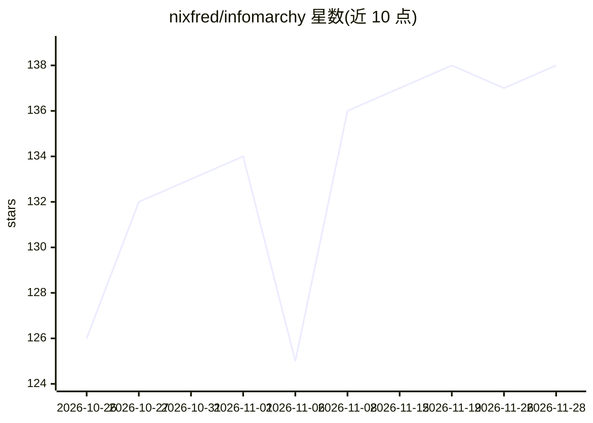

# nixfred/infomarchy

⭐ 138 · TypeScript · MIT · 推送 2026-11-17 · [GitHub](https://github.com/nixfred/infomarchy) · 个人维护

**把 Hyprland 壁纸变成监控本机 AI agent 运行的仪表盘**

一个 Omarchy（Arch/Hyprland）桌面插件，基于 Quickshell 用 bun 运行，把当前壁纸渲染成信息面板：从 /proc 检测正在运行的 AI agent（Claude Code、Codex、Grok、Ollama、Cursor、aider 等），逐个显示会话卡片，附带 7 天热力图、用量限额、最近任务与机器资源统计。无需 agent 侧挂钩；点击卡片可跳转到对应终端或窗口，支持 STALE 会话识别、静默会话分组、tmux/Herdr/Boomux 多路复用器跳转。主题驱动，SUPER+I 可隐藏面板。

## 筛选速览

| 维度 | 判定 | 备注 |
|---|---|---|
| AI 角色 | `ai-ecosystem` | LLM/agent 周边工具 |
| 许可风险 | `permissive` | MIT |
| 部署形态 | `None` |  |
| 模型依赖 | local-ok | 支持本地模型 |
| 硬件要求 | — | 无带数字的原话,不猜 |
| 安装摩擦 | `low` | 无编译、无系统依赖或容器化 |
| 成熟度 | — | 结构信号不足 |

## 能力要点

- 从 /proc 直接检测 13 种以上 AI agent 会话，无需配置
- 本地 Ollama 模型可选优化会话主题摘要，且不阻塞刷新
- STALE 标记与右键停止/终止进程（二次确认）
- tmux/Herdr/Boomux 会话可见并支持点击跳转

## 适用场景

- 同时开多个终端跑 Claude Code/Codex 时一眼掌握各会话状态
- 盯住每周用量限额，避免额度悄悄耗尽
- 发现并清理后台遗留的僵死 agent 会话

## 场景标签

`LLM 可观测性` · 领域:评测与运维

## 证据(README 行号)

> L4:  Every AI agent running on your machine, what it's doing, what it cost you, and how the box is holding up —
> L31: One card per running agent — **Claude Code, Codex, Cursor, Grok, Grok Bot, Gemini, Hermes, opencode, Pi, Oh My Pi, 

## 星数曲线

2026-10-26 126 → 2026-11-28 138（+12）

---
*卡片 v1 · prompt 1.4 · 生成 2026-11-28 · 置信度 mid · 依据 README sha `181153cee671` · [字段定义](../../DATASET.md)*
