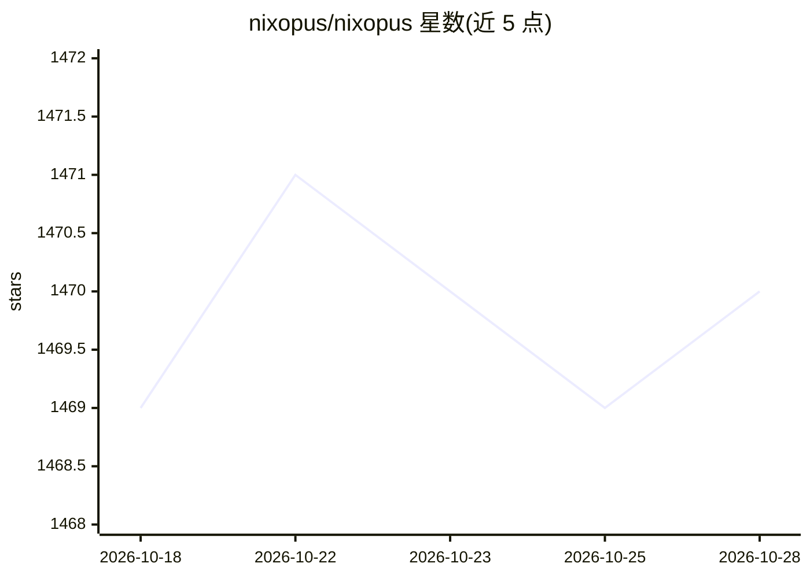

# nixopus/nixopus

⭐ 1,470 · Go · NOASSERTION · 推送 2026-10-25 · [GitHub](https://github.com/nixopus/nixopus) · [官网](https://nixopus.com) · 组织维护

**带自主 AI Agent 的自托管应用部署平台**

开源部署平台：AI agent 分析代码库、生成构建配置、部署应用，并在失败时读取日志、提修复 PR 并重新部署（自愈功能标注开发中）。用户通过对话界面或 VS Code/Cursor 扩展用自然语言操作部署、域名、回滚与排障。支持多服务器管理、浏览器内终端与容器查看，基于 Docker 与 Caddy 提供自动 TLS。可自托管（curl 一键安装，需 root VPS，1GB 内存起），LLM 后端可选 OpenRouter/OpenAI/Anthropic/Google/DeepSeek/Groq。

## 筛选速览

| 维度 | 判定 | 备注 |
|---|---|---|
| AI 角色 | `ai-enhanced` | 去掉 AI 部分产品仍成立 |
| 许可风险 | `none` | NOASSERTION |
| 部署形态 | `None` |  |
| 模型依赖 | locked-api |  |
| 硬件要求 | — | 无带数字的原话,不猜 |
| 安装摩擦 | `low` | 无编译、无系统依赖或容器化 |
| 成熟度 | `idea` | |

## 能力要点

- AI agent 自动生成配置、部署并修复失败（读取日志→PR→重新部署）
- 对话界面与 VS Code/Cursor 扩展中用自然语言管理部署
- 多服务器统一管理、浏览器内 SSH 终端与容器日志
- 框架无关：任何可容器化的应用均可部署，自动 TLS/域名/回滚

## 适用场景

- 在自己的 VPS 上自托管部署生产应用并获得自动 HTTPS
- 部署失败时让 agent 自动诊断并提修复 PR
- 从编辑器侧边栏对话完成部署与运维操作

## 场景标签

`编码 Agent` · 领域:编码与开发

## 证据(README 行号)

> L3: First open-source deployment platform with an autonomous AI agent to deploy, monitor, and heal your apps.
> L37: Nixopus is the deployment platform where an AI agent handles your entire deploy lifecycle, from analyzing your code
> L60: The agent generates configs, deploys, and fixes failures, autonomously. On other platforms, a failed deployment mea

## 星数曲线

2026-10-18 1,469 → 2026-10-28 1,470（+1）

---
*卡片 v1 · prompt 1.4 · 生成 2026-10-21 · 置信度 high · 依据 README sha `04f97d8fff3f` · [字段定义](../../DATASET.md)*
