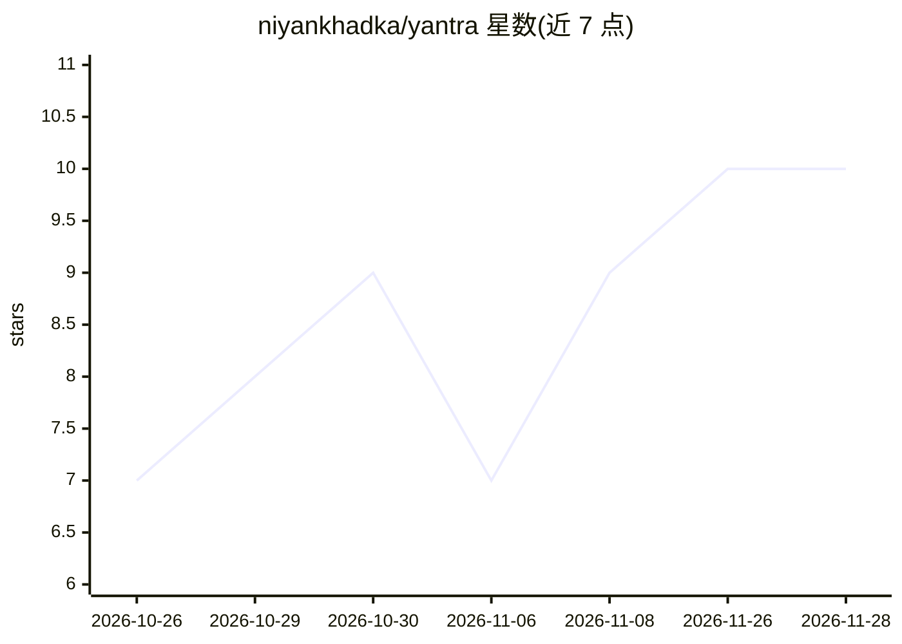

# niyankhadka/yantra

⭐ 10 · JavaScript · MIT · 推送 2026-11-24 · [GitHub](https://github.com/niyankhadka/yantra) · [官网](https://yantra.nbk.com.np/) · 个人维护

**把描述或 agent 生成的 JSON 转成可分步讲解的交互式图表**

Yantra 提供 CLI、MCP 服务器、playground 与 Python SDK：用户或编码 agent 写 JSON，工具自动排版与路由连线，验证器检查坏引用、卡片重叠与标签碰撞并返回带稳定代码的发现供 agent 自修复，输出单文件离线 HTML 或 SVG/PNG/Markdown 导出，支持架构图、时序图、状态机、ER 图、答案页与书籍模式。可导入 Mermaid、PlantUML、draw.io、Visio 文件。提供编码 agent skill 安装命令与面向 AI 聊天的提示词复制流程。需要 Node.js 20.19 以上。

## 筛选速览

| 维度 | 判定 | 备注 |
|---|---|---|
| AI 角色 | `ai-ecosystem` | LLM/agent 周边工具 |
| 许可风险 | `permissive` | MIT |
| 部署形态 | `library` | 以包/库形式分发 |
| 模型依赖 | — | README 未给出锁定关系 |
| 硬件要求 | — | 无带数字的原话,不猜 |
| 安装摩擦 | `low` | 无编译、无系统依赖或容器化 |
| 成熟度 | — | 结构信号不足 |

## 能力要点

- 验证器输出稳定错误码，供 agent 自行修复 JSON
- 单文件离线 HTML 输出，另支持 SVG/PNG/Markdown 导出
- MCP 服务器（stdio 与 Streamable HTTP）提供 schema/validate/build 等工具
- 导入 Mermaid、PlantUML、draw.io 与 Visio 文件

## 适用场景

- 让编码 agent 读取代码库并生成分步讲解的架构图
- 把已有 Mermaid/PlantUML/Visio 图转成可走读的故事
- SRE 团队制作含时间线与原因的事后复盘答案页
- 在 playground 中粘贴 AI 聊天返回的 JSON 并验证渲染

## 场景标签

 · 领域:开发者工具/文档与可视化

## 证据(README 行号)

> L161: - **For agents:** a validator with stable codes, a CLI, an MCP server (stdio and Streamable
> L206: `yantra mcp` (or `node mcp/server.js`) speaks MCP over stdio; `yantra init` registers it for

## 星数曲线

2026-10-26 7 → 2026-11-28 10（+3）

---
*卡片 v1 · prompt 1.4 · 生成 2026-11-20 · 置信度 high · 依据 README sha `6cc36684c910` · [字段定义](../../DATASET.md)*
