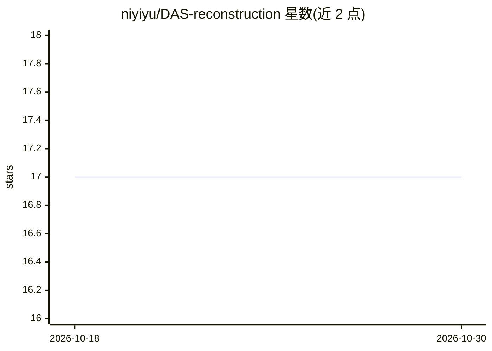

# niyiyu/DAS-reconstruction

⭐ 17 · Jupyter Notebook · GPL-3.0 · 推送 2026-01-15 · [GitHub](https://github.com/niyiyu/DAS-reconstruction) · 个人维护

**面向地震科研者的 DAS 波场重建机器学习代码与教程集**

学术论文（JGR: Machine Learning and Computation 2024）配套仓库，提供分布式声波传感（DAS）数据波场重建的模型训练与推理 notebook 教程，比较 SHallow REcurrent Decoder（SHRED）与 Implicit Neural Representation（INR，含 SIREN 与 RFFN）等架构，用于数据压缩与波场分离。全部代码基于 PyTorch 实现。所用 Cook Inlet DAS 地震数据约 260 GB/缆，未直接入库，提供 download.py 脚本与事件清单从归档服务器下载。GPL v3 许可。

## 筛选速览

| 维度 | 判定 | 备注 |
|---|---|---|
| AI 角色 | `ai-native` | 本体是模型或模型工具 |
| 许可风险 | `viral` | GPL-3.0 |
| 部署形态 | `None` |  |
| 模型依赖 | — | README 未给出锁定关系 |
| 硬件要求 | — | 无带数字的原话,不猜 |
| 安装摩擦 | `low` | 无编译、无系统依赖或容器化 |
| 成熟度 | — | 结构信号不足 |

## 能力要点

- 提供 SHRED 与 INR（SIREN/RFFN）模型的训练与推理 notebook
- 面向 DAS 数据的有损压缩与波场分离任务
- 提供脚本从归档服务器下载 Cook Inlet 地震数据

## 适用场景

- 复现论文中的 DAS 波场重建实验
- 学习将 DAS 数据作为二维数组处理的神经网络方法
- 获取 Cook Inlet DAS 地震实验数据

## 场景标签

`科研工具` `教程课程` · 领域:学习与行业

## 证据(README 行号)

> L4: This study explores wavefield reconstruction using machine learning methods for data compression and wavefield separ
> L7: This repository provides independent notebook examples of model training and inference performed in the manuscript. 

## 星数曲线

2026-10-18 17 → 2026-10-30 17（+0）

---
*卡片 v1 · prompt 1.4 · 生成 2026-10-29 · 置信度 high · 依据 README sha `23f925d52f57` · [字段定义](../../DATASET.md)*
