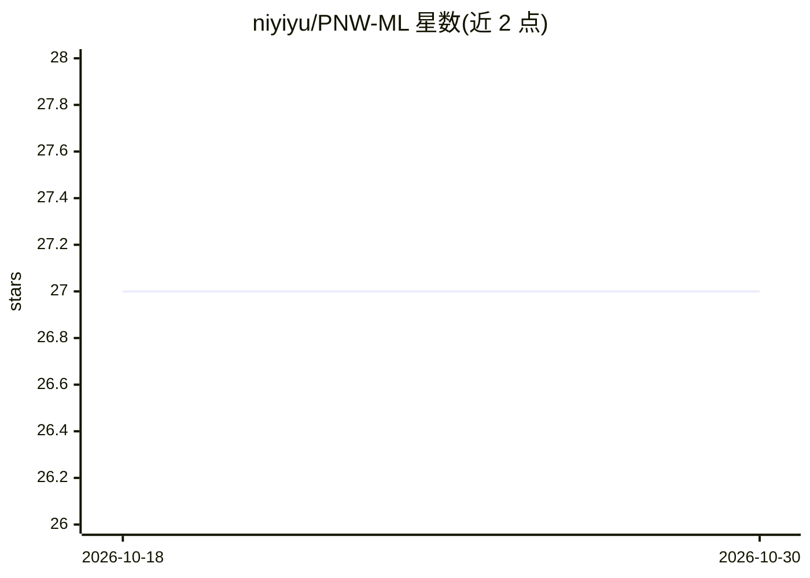

# niyiyu/PNW-ML

⭐ 27 · Jupyter Notebook · MIT · 推送 2026-05-04 · [GitHub](https://github.com/niyiyu/PNW-ML) · 组织维护

**太平洋西北地区地震信号 ML 数据集（HDF5+CSV）**

面向地震学机器学习研究的策展数据集：收录美国太平洋西北地区 ComCat 地震事件、噪声、特殊事件（爆炸/音爆/雷鸣等）与北加州序列的波形数据，每个数据集由 HDF5 波形与 CSV 元数据组成，遵循 SeisBench 格式，元数据含震源参数、台站信息与 P/S 到时标注。提供 micro/mini/meso 三种缩减版及 ML 增强目录，托管于 Google Drive 与 UW-ESS 服务器，也可经 SeisBench API 获取。附论文引用与已知数据问题记录。

## 筛选速览

| 维度 | 判定 | 备注 |
|---|---|---|
| AI 角色 | `ai-knowledge` | 知识聚合/清单类 |
| 许可风险 | `permissive` | MIT |
| 部署形态 | `None` |  |
| 模型依赖 | — | README 未给出锁定关系 |
| 硬件要求 | — | 无带数字的原话,不猜 |
| 安装摩擦 | `low` | 无编译、无系统依赖或容器化 |
| 成熟度 | — | 结构信号不足 |

## 能力要点

- ComCat/噪声/特殊事件等多类波形数据，遵循 SeisBench 格式
- 元数据含 P/S 到时样本、不确定度与 SNR 标注
- 提供 micro/mini/meso 缩减版与 Jupyter/Colab 示例
- 托管于 Google Drive 与 UW-ESS，另可经 SeisBench API 访问

## 适用场景

- 训练地震信号检测或震相拾取模型
- 获取带 P/S 到时标注的区域波形数据
- 地震学 ML 方法的基准数据来源

## 场景标签

 · 领域:地球科学/地震学

## 证据(README 行号)

> L1: # Pacific Northwest Curated Seismic Dataset
> L33: ### 5. ML-enhanced catalog

## 星数曲线

2026-10-18 27 → 2026-10-30 27（+0）

---
*卡片 v1 · prompt 1.4 · 生成 2026-10-26 · 置信度 high · 依据 README sha `5974a8803963` · [字段定义](../../DATASET.md)*
