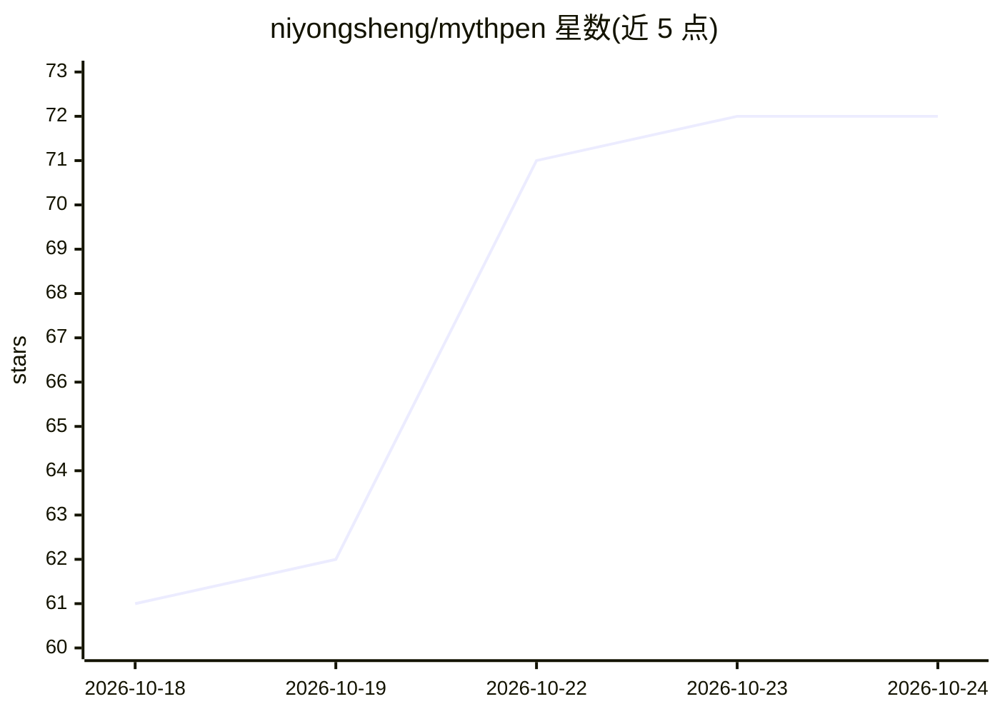

# niyongsheng/mythpen

⭐ — · [GitHub]() · 个人维护 · 中文 README

**给小说作者的 AI 辅助写作桌面应用：管理角色、章节、伏笔等创作要素**

基于 Tauri v2 的跨平台桌面应用，面向小说作者：集中管理角色、世界观、章节、伏笔、时间线与人物关系，内置 AI 写作助手（引导式 6 步写作与 AI 协作两种模式），支持 OpenAI 与 Claude，AI 接口为 OpenAI 兼容。可导入 TXT/EPUB 旧作，由模型识别卷章并自动构建角色、时间线等结构。数据以 SQLite 本地存储于 ~/.mythpen/，无需云端。界面支持 8 种语言，采用 GPL-3.0 许可。

## 筛选速览

| 维度 | 判定 | 备注 |
|---|---|---|
| AI 角色 | `ai-enhanced` | 去掉 AI 部分产品仍成立 |
| 许可风险 | `viral` | — |
| 部署形态 | `desktop` | 安装包/桌面程序 |
| 模型依赖 | locked-api |  |
| 硬件要求 | — | 无带数字的原话,不猜 |
| 安装摩擦 | `low` | 无编译、无系统依赖或容器化 |
| 成熟度 | — | 结构信号不足 |

## 能力要点

- AI 写作双模式：6 步引导流程与 AI 协作共同写作
- TXT/EPUB 导入后由模型检测卷章并构建角色、时间线、伏笔与叙事记忆
- 角色、世界观、章节、伏笔、时间线、关系统一管理
- 本地优先：数据存于 SQLite ~/.mythpen/，无需云端

## 适用场景

- 写网文时统一管理角色设定、伏笔与时间线
- 让 AI 按引导流程或协作模式续写章节
- 把已有的 TXT/EPUB 小说导入并重建设定库

## 场景标签

`AI 写作` `知识库管理` · 领域:内容生成

## 证据(README 行号)

> L5:  AI-assisted novel writing desktop app — characters, world-building, chapters, foreshadowing, timelines, with integr
> L17: - **AI Writing** — Two modes: *Writing* (guided 6-step workflow) and *Collab* (AI co-writer). Supports OpenAI and C

## 星数曲线

2026-10-18 61 → 2026-10-24 72（+11）

---
*卡片 v1 · prompt 1.4 · 生成 2026-10-24 · 置信度 high · 依据 README sha `489390b91abf` · [字段定义](../../DATASET.md)*
