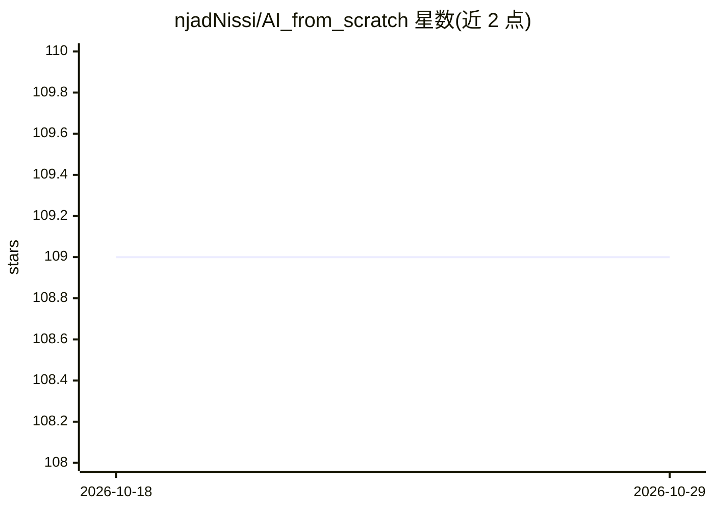

# njadNissi/AI_from_scratch

⭐ 109 · Python · 推送 2026-04-29 · [GitHub](https://github.com/njadNissi/AI_from_scratch) · 个人维护 · 中文 README

**从零实现 AI 模型并讲解边缘部署与 TinyML 的教学仓库**

面向 AI 模型开发初学者的教学仓库：目标是从零构建 ML/DL/NN 的简化版本以帮助理解概念，并延伸到模型在边缘设备与嵌入式系统上的部署。内容以概念讲解为主：介绍 AI/ML/IoT/边缘设备/TinyML 定义，列举线性回归、决策树、CNN 等常用算法，讲解量化、剪枝、知识蒸馏等模型压缩技术，梳理 TensorFlow Lite、AIfES、Edge Impulse 等框架，并给出智能家居、工业物联网、医疗、农业四类用例。仓库分 ML 与 ML_IoT 两个目录。README 未给出安装或运行命令。

## 筛选速览

| 维度 | 判定 | 备注 |
|---|---|---|
| AI 角色 | `ai-knowledge` | 知识聚合/清单类 |
| 许可风险 | `none` | — |
| 部署形态 | `None` |  |
| 模型依赖 | — | README 未给出锁定关系 |
| 硬件要求 | — | 无带数字的原话,不猜 |
| 安装摩擦 | `low` | 无编译、无系统依赖或容器化 |
| 成熟度 | — | 结构信号不足 |

## 能力要点

- 从零实现 ML/DL/NN 简化版本以讲解概念
- 覆盖量化、剪枝、知识蒸馏等 TinyML 模型压缩技术
- 介绍 TensorFlow Lite、AIfES、Edge Impulse 等嵌入式框架
- 目录分为 ML（常规电脑）与 ML_IoT（嵌入式系统）两部分

## 适用场景

- 系统学习 TinyML 与边缘 AI 的基础概念
- 了解 ML 模型如何部署到微控制器等资源受限设备
- 查找适合 IoT 场景的机器学习算法与框架入门材料

## 场景标签

`教程课程` · 领域:学习与行业

## 证据(README 行号)

> L3: This repo is created to give a solid foundation on AI model Development with machine Learning techniques. We extend 
> L7: - ML: this folder introduces Machine Learning Model Development and Deployment on typical computers.

## 星数曲线

2026-10-18 109 → 2026-10-29 109（+0）

---
*卡片 v1 · prompt 1.4 · 生成 2026-10-23 · 置信度 high · 依据 README sha `535730ef420f` · [字段定义](../../DATASET.md)*
