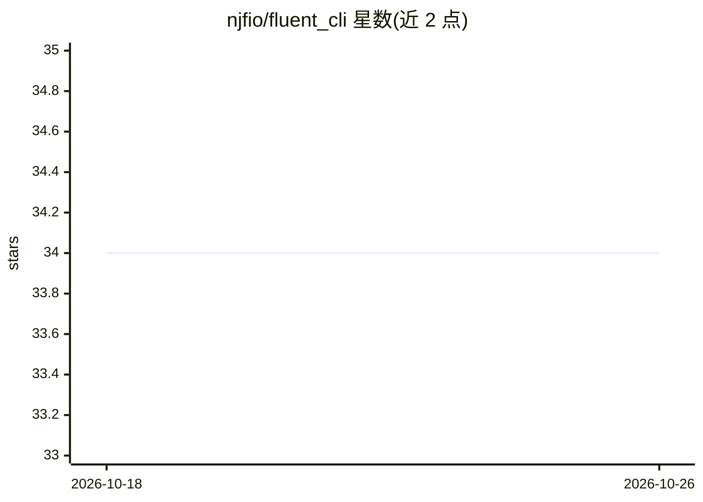

# njfio/fluent_cli

⭐ 34 · Rust · Apache-2.0 · 推送 2026-01-23 · [GitHub](https://github.com/njfio/fluent_cli) · [官网](https://fluentcli.com) · 个人维护

**Rust 编写的多 LLM 提供商统一命令行客户端**

基于 Rust 的命令行工具，为开发者提供 OpenAI、Anthropic、Google Gemini、Cohere、Mistral、Perplexity、Groq 等多家 LLM 服务商的统一查询接口，支持文本与图像视觉请求、YAML 配置多引擎、YAML 定义多步流水线、请求缓存与限流。附带实验性 Agent 能力：ReAct 循环、文件/Shell/代码分析工具、字符串替换编辑器、SQLite 记忆系统、MCP 客户端与服务端（STDIO/HTTP）、Neo4j 集成与 TUI 实时监控。通过 git clone 加 cargo build --release 从源码构建安装，README 未提供预编译二进制或包管理器安装方式。

## 筛选速览

| 维度 | 判定 | 备注 |
|---|---|---|
| AI 角色 | `ai-ecosystem` | LLM/agent 周边工具 |
| 许可风险 | `permissive` | Apache-2.0 |
| 部署形态 | `None` |  |
| 模型依赖 | locked-api |  |
| 硬件要求 | — | 无带数字的原话,不猜 |
| 安装摩擦 | `medium` | 含编译或系统依赖之一 |
| 成熟度 | `idea` | |

## 能力要点

- 统一 CLI 接入 OpenAI/Anthropic/Gemini/Cohere/Mistral/Perplexity/Groq 等多家提供商
- YAML 配置多引擎与 YAML 定义多步流水线执行
- 实验性 Agent：ReAct 循环、工具系统、SQLite 记忆、MCP 客户端与服务端
- TUI 实时监控（含 ASCII 自动回退）与命令注入防护等安全功能

## 适用场景

- 在终端用统一命令切换查询不同 LLM 提供商
- 用 YAML 定义多步 LLM 工作流并执行
- 通过 MCP 集成工具或启动 MCP 服务端

## 场景标签

`模型网关` `Agent 框架` `工作流自动化` · 领域:Agent 开发

## 证据(README 行号)

> L3: A modern, secure, and modular Rust-based command-line interface for interacting with multiple Large Language Model (
> L75: - **OpenAI**: GPT models with text and vision capabilities
> L83: - **Direct LLM Queries**: Send text prompts to any supported LLM provider

## 星数曲线

2026-10-18 34 → 2026-10-26 34（+0）

---
*卡片 v1 · prompt 1.4 · 生成 2026-10-25 · 置信度 high · 依据 README sha `2cfa6d60a942` · [字段定义](../../DATASET.md)*
