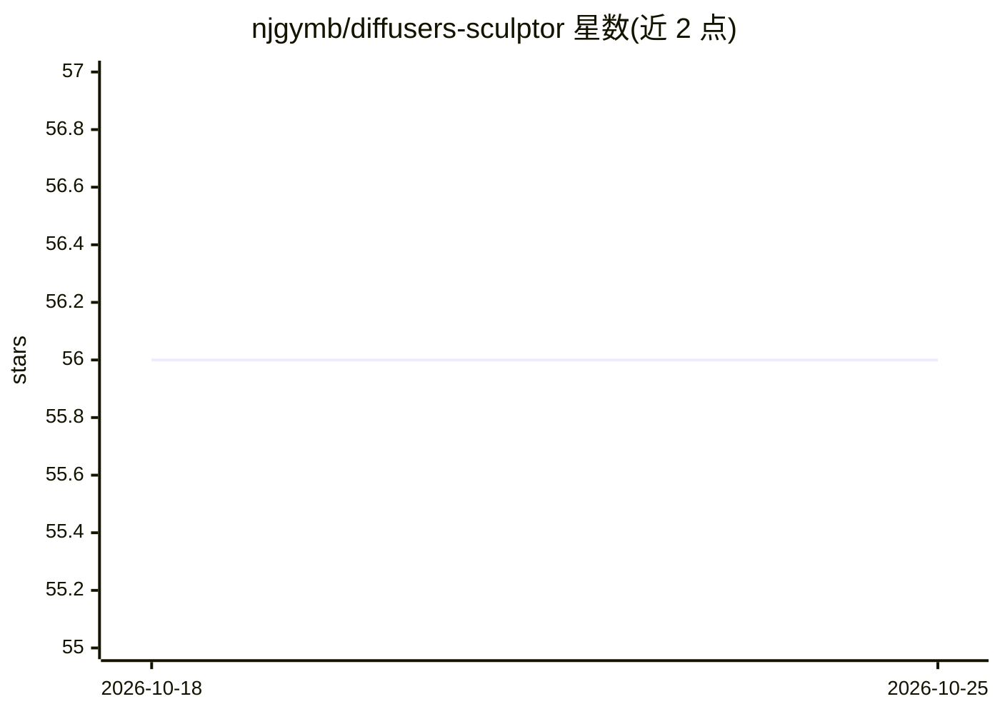

# njgymb/diffusers-sculptor

⭐ 56 · HTML · 推送 2026-10-24 · [GitHub](https://github.com/njgymb/diffusers-sculptor) · 个人维护

**配置驱动的扩散模型微调框架（FluxForge）**

面向扩散模型微调的 Python 训练框架：以单一 YAML 文件作为实验的唯一事实来源，声明式描述从数据加载到 checkpoint 序列化的全流程。提供组件级冻结（cross-attention/FFN/text encoder 分阶段训练）、加权采样的数据轮播、内存弹性梯度累积（按实时 VRAM 分块批处理）、交互式 loss landscape HTML 可视化、多阶段课程式调参、多种子集成分析与多语言 caption 本地翻译归一化。兼容 Diffusers ≥ 0.30 / PyTorch ≥ 2.1 / Python 3.10+，经 PyPI 以 fluxforge 包分发，依赖 torch/transformers/accelerate/safetensors。声明为研究工具，不替代对训练动力学的理解。

## 筛选速览

| 维度 | 判定 | 备注 |
|---|---|---|
| AI 角色 | `ai-ecosystem` | LLM/agent 周边工具 |
| 许可风险 | `none` | — |
| 部署形态 | `library` | 以包/库形式分发 |
| 模型依赖 | — | README 未给出锁定关系 |
| 硬件要求 | — | 无带数字的原话,不猜 |
| 安装摩擦 | `low` | 无编译、无系统依赖或容器化 |
| 成熟度 | — | 结构信号不足 |

## 能力要点

- YAML 单一配置描述整个微调流程，支持 Pydantic schema 校验
- 组件级冻结与多阶段课程式调参（UNet/text encoder 分阶段）
- 内存弹性梯度累积：按实时 VRAM 自动分块，支持 12GB 显卡微调
- t-SNE 嵌入投影、逐层梯度范数热图等交互式 HTML 可视化

## 适用场景

- 用一份可版本化的 YAML 复现和分享扩散模型微调实验
- 在单张消费级 GPU 上微调大型扩散模型
- 对同一配置跑多种子集成并自动选优 checkpoint

## 场景标签

`微调` · 领域:训练与推理

## 证据(README 行号)

> L16: This framework treats your fine-tuning process as a **declarative pipeline description** rather than an imperative 
> L20: Most fine-tuning codebases become tangled webs of flags, callbacks, and hard-coded paths. FluxForge inverts this by

## 星数曲线

2026-10-18 56 → 2026-10-25 56（+0）

---
*卡片 v1 · prompt 1.4 · 生成 2026-10-24 · 置信度 high · 依据 README sha `cab1bffb120a` · [字段定义](../../DATASET.md)*
