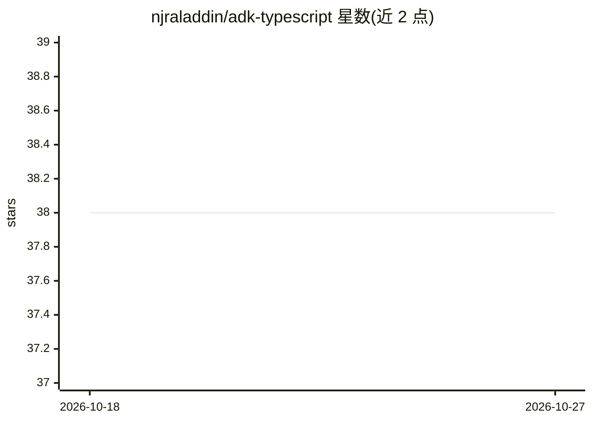

# njraladdin/adk-typescript

⭐ 38 · TypeScript · Apache-2.0 · 推送 2025-11-04 · [GitHub](https://github.com/njraladdin/adk-typescript) · [官网](https://njraladdin.github.io/adk-typescript) · 个人维护

**TypeScript 版 Google ADK：构建/评估/部署 AI agent 的工具包**

Google ADK Python 库的非官方 TypeScript 移植，代码优先的 agent 开发框架：以 TypeScript 定义 agent、工具与编排，支持多 agent 层级组合、OpenAPI 工具接入、双向流式交互（Runner.runLive）。提供 CLI（npx adk）覆盖创建、运行、Web UI 调试、REST API 服务、.test.json 数据集评测、agent 图生成（需 Graphviz）与 Cloud Run 部署。模型无关但面向 Gemini 优化，集成 Google 生态。README 声明处于 alpha 实验阶段，API 可能变动。

## 筛选速览

| 维度 | 判定 | 备注 |
|---|---|---|
| AI 角色 | `ai-ecosystem` | LLM/agent 周边工具 |
| 许可风险 | `permissive` | Apache-2.0 |
| 部署形态 | `library` | 以包/库形式分发 |
| 模型依赖 | — | README 未给出锁定关系 |
| 硬件要求 | — | 无带数字的原话,不猜 |
| 安装摩擦 | `low` | 无编译、无系统依赖或容器化 |
| 成熟度 | `idea` | |

## 能力要点

- npx adk CLI：创建/运行/Web UI/API 服务/评测/部署一站式命令
- 多 agent 层级组合与双向流式（runLive/LiveRequestQueue）
- 内置 .test.json 数据集评测（npx adk eval）
- 可部署至 Cloud Run、Docker 或任意平台

## 适用场景

- 用 TypeScript 构建、测试并部署 AI agent
- 通过本地 Web UI 调试与检查 agent 执行
- 将 agent 打包为 REST 服务用于集成测试

## 场景标签

`Agent 框架` `多智能体` `模型评测` · 领域:Agent 开发

## 证据(README 行号)

> L10:  An open-source, code-first TypeScript toolkit for building, evaluating, and deploying sophisticated AI agents with
> L19: **ADK TypeScript** is a code-first framework for building and deploying AI agents. Optimized for Gemini but model-a

## 星数曲线

2026-10-18 38 → 2026-10-27 38（+0）

---
*卡片 v1 · prompt 1.4 · 生成 2026-10-25 · 置信度 high · 依据 README sha `09019e840bcd` · [字段定义](../../DATASET.md)*
