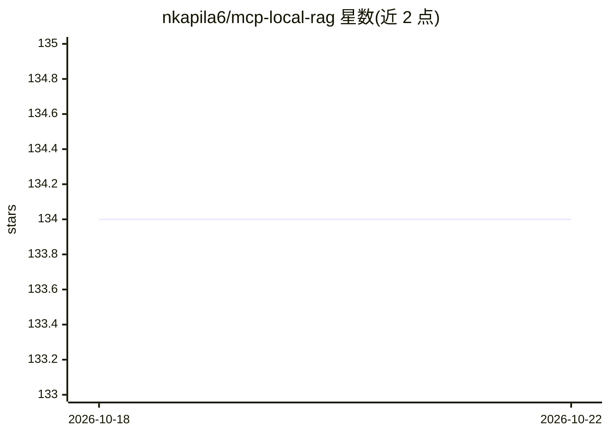

# nkapila6/mcp-local-rag

⭐ 134 · Python · MIT · 推送 2026-08-31 · [GitHub](https://github.com/nkapila6/mcp-local-rag) · 个人维护

**本地运行的 RAG 式网页搜索 MCP 服务器，无需 API key**

一个完全本地运行的 MCP 服务器，为 LLM 提供网页搜索与深度研究工具：支持 DuckDuckGo、Google、Bing、Brave 等 9+ 搜索后端，内置嵌入模型做 RAG 式语义相似度排序，全程无需 API key。提供 deep_research、rag_search_ddgs 等工具，兼容任何支持工具调用的 MCP 客户端（已在 Claude Desktop、Cursor、Goose 上测试），安装方式为 uvx 直接运行或 Docker。另附教 Claude 使用这些工具的 Agent Skills。

## 筛选速览

| 维度 | 判定 | 备注 |
|---|---|---|
| AI 角色 | `ai-ecosystem` | LLM/agent 周边工具 |
| 许可风险 | `permissive` | MIT |
| 部署形态 | `None` |  |
| 模型依赖 | — | README 未给出锁定关系 |
| 硬件要求 | — | 无带数字的原话,不猜 |
| 安装摩擦 | `low` | 无编译、无系统依赖或容器化 |
| 成熟度 | — | 结构信号不足 |

## 能力要点

- 9+ 搜索后端（DuckDuckGo/Google/Bing/Brave/Wikipedia 等）多引擎研究
- RAG 式语义相似度排序，处理全程本地、无需 API key
- 提供 deep_research / rag_search 系列工具，后端与结果数可定制
- 附带 Claude Agent Skills 指导工具选择与查询构造

## 适用场景

- 让 Claude Desktop 等 MCP 客户端获取实时网页信息
- 跨多搜索引擎做深度研究与多视角资料收集
- 隐私优先场景下用 DuckDuckGo/Brave 做本地化搜索

## 场景标签

`RAG` · 领域:知识与检索

## 证据(README 行号)

> L4: A RAG-based web search and deep research model context protocol (MCP) server that runs entirely locally. Features mu
> L110: # MCP Clients

## 星数曲线

2026-10-18 134 → 2026-10-22 134（+0）

---
*卡片 v1 · prompt 1.4 · 生成 2026-10-22 · 置信度 high · 依据 README sha `e4e50c6e2980` · [字段定义](../../DATASET.md)*
