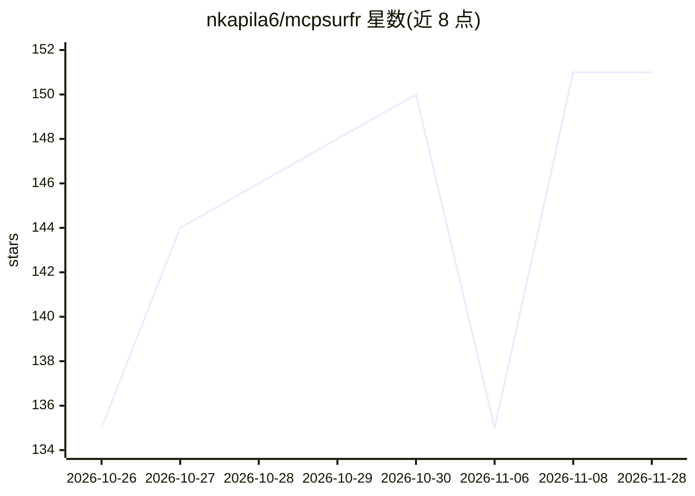

# nkapila6/mcpsurfr

⭐ 151 · Python · MIT · 推送 2026-11-23 · [GitHub](https://github.com/nkapila6/mcpsurfr) · 个人维护

**无 API key 的本地网页搜索 MCP 服务器，结果在本机重排**

通过 MCP 协议为 LLM 客户端提供网页搜索：ddgs 向多个引擎同时查询，MobileBERT 模型在本机用 BM25 加嵌入重排结果，仅抓取并返回最相关的段落（约省十分之九 token），支持 PDF 文本层、llms.txt 站点、Stack Exchange/Wikipedia 等免费 API，并报告被跳过的页面及原因。提供 search、rag_search_ddgs、deep_research、read_url 四个工具与时效/地区/域名过滤参数。通过 PyPI 的 uvx 或 Docker（amd64/arm64）安装，无需任何 API key。

## 筛选速览

| 维度 | 判定 | 备注 |
|---|---|---|
| AI 角色 | `ai-ecosystem` | LLM/agent 周边工具 |
| 许可风险 | `permissive` | MIT |
| 部署形态 | `library` | 以包/库形式分发 |
| 模型依赖 | — | README 未给出锁定关系 |
| 硬件要求 | — | 无带数字的原话,不猜 |
| 安装摩擦 | `low` | 无编译、无系统依赖或容器化 |
| 成熟度 | — | 结构信号不足 |

## 能力要点

- 无需 API key，ddgs auto 模式查询多个引擎并跳过被封锁的
- MobileBERT + BM25 在本机重排结果，只返回相关段落
- 支持 PDF 读取、llms.txt 站点与 Stack Exchange/Wikipedia 等免费 API
- 提供 search/deep_research/read_url 工具及 recency/region/域名过滤参数

## 适用场景

- 让 Claude Desktop 检索训练数据之后的新信息
- 给 MCP 客户端配置无 key 的联网搜索工具
- 用 deep_research 多搜索词合并去重并生成带引用的摘要
- 在屏蔽爬虫的站点（Stack Overflow、Wikipedia、GitHub）获取内容

## 场景标签

`RAG` · 领域:知识与检索

## 证据(README 行号)

> L3:  Local web search for your LLM over MCP. No API keys, and results are ranked on your machine. Formerly <code>mcp-loc
> L53: Other keyless MCP servers (mcp-searxng, duckduckgo-mcp-server, open-webSearch, the official fetch server) hand the 

## 星数曲线

2026-10-26 135 → 2026-11-28 151（+16）

---
*卡片 v1 · prompt 1.4 · 生成 2026-11-27 · 置信度 high · 依据 README sha `f04751c78aa7` · [字段定义](../../DATASET.md)*
