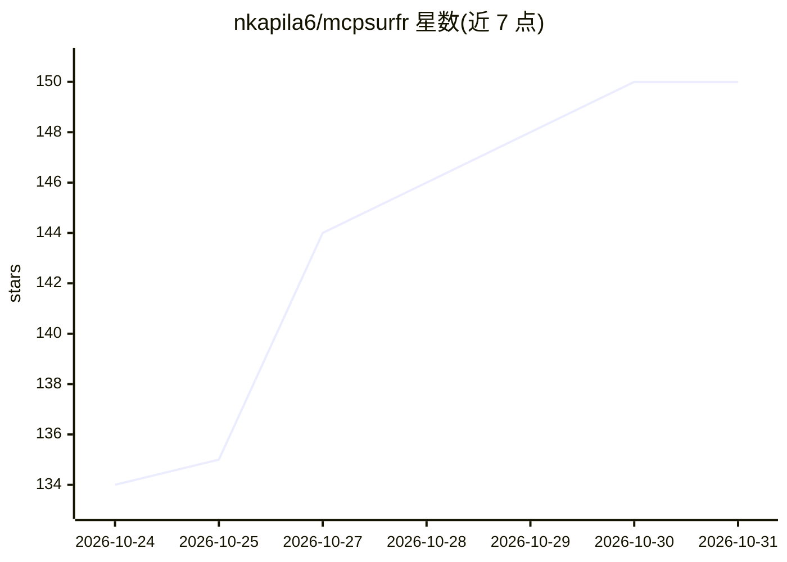

# nkapila6/mcpsurfr

⭐ 150 · Python · MIT · 推送 2026-10-29 · [GitHub](https://github.com/nkapila6/mcpsurfr) · 个人维护

**本地网页搜索 MCP 服务器：LLM 无 API key 联网检索**

面向 LLM 客户端的 MCP 服务器，提供本地网页搜索：通过 ddgs 多引擎检索、无需 API key，由设备上的 MobileBERT（numpy 实现）对结果重排序，抓取页面时保留正文并去重，search 返回相关段落而非整页。提供 search 与 deep_research 等多组工具，后端支持 auto/brave/duckduckgo/google 等。内置技能与 research 提示词供客户端自动拾取。经 uv 或 Docker（amd64/arm64）安装，测试于 Claude Desktop、Claude Code、Cursor 与 Goose。

## 筛选速览

| 维度 | 判定 | 备注 |
|---|---|---|
| AI 角色 | `ai-ecosystem` | LLM/agent 周边工具 |
| 许可风险 | `permissive` | MIT |
| 部署形态 | `None` |  |
| 模型依赖 | — | README 未给出锁定关系 |
| 硬件要求 | — | 无带数字的原话,不猜 |
| 安装摩擦 | `low` | 无编译、无系统依赖或容器化 |
| 成熟度 | — | 结构信号不足 |

## 能力要点

- ddgs 多引擎检索，无需 API key
- MobileBERT 在本地对结果重排序
- search 返回相关段落，约十分之一 token 量
- 随服务分发 mcpsurfr-search 技能与 research 提示词

## 适用场景

- 让 Claude Desktop 等客户端查询训练截止日期之后的信息
- 对多搜索词做合并去重的深度检索并产出带引用的摘要
- 在不申请搜索 API key 的前提下给 LLM 加联网能力

## 场景标签

 · 领域:LLM 基础设施/MCP

## 证据(README 行号)

> L3: Local web search for your LLM over MCP. No API keys, and results are ranked on your machine. _Formerly `mcp-local-ra
> L17: - **Ranked locally.** A small MobileBERT model on plain numpy re-ranks results, so only the best pages get fetched.

## 星数曲线

2026-10-24 134 → 2026-10-31 150（+16）

---
*卡片 v1 · prompt 1.4 · 生成 2026-10-23 · 置信度 high · 依据 README sha `aa51dc7ee6c8` · [字段定义](../../DATASET.md)*
