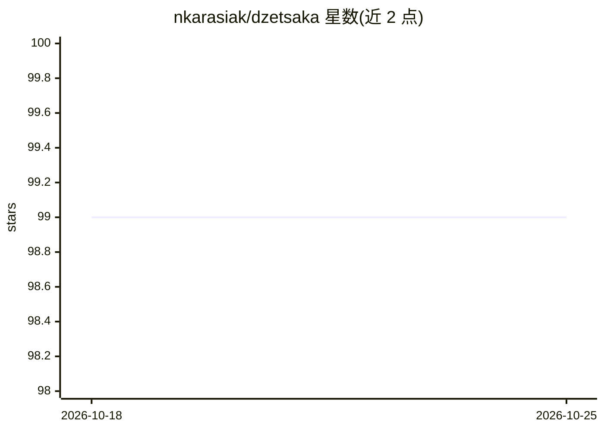

# nkarasiak/dzetsaka

⭐ 99 · Python · GPL-3.0 · 推送 2026-10-01 · [GitHub](https://github.com/nkarasiak/dzetsaka) · 个人维护

**QGIS 遥感影像分类插件：11 种机器学习算法**

dzetsaka 是 QGIS 的栅格分类插件，提供 GMM、随机森林、SVM、KNN 等 11 种机器学习算法，输入为栅格与含类别编号的 ROI shapefile。支持交叉验证网格搜索调参、Optuna 大参数空间搜索、SHAP 解释与 SMOTE 类别不平衡处理；稀疏类别标签自动编码。核心 ML 代码位于共享 dzetsaka 包，可不依赖 QGIS 运行，支持 CLI 与批处理（pip 安装后使用 train/classify 命令）。XGBoost/CatBoost 需另装库，可选自动依赖安装。

## 筛选速览

| 维度 | 判定 | 备注 |
|---|---|---|
| AI 角色 | `ai-native` | 本体是模型或模型工具 |
| 许可风险 | `viral` | GPL-3.0 |
| 部署形态 | `library` | 以包/库形式分发 |
| 模型依赖 | — | README 未给出锁定关系 |
| 硬件要求 | — | 无带数字的原话,不猜 |
| 安装摩擦 | `low` | 无编译、无系统依赖或容器化 |
| 成熟度 | — | 结构信号不足 |

## 能力要点

- 11 种机器学习分类算法（GMM 无需 scikit-learn）
- 交叉验证网格搜索与 Optuna 调参
- SHAP 解释与 SMOTE 类别不平衡处理
- ML 核心可脱离 QGIS 运行，提供 CLI 训练/分类命令

## 适用场景

- 在 QGIS 中基于 ROI 对遥感影像做地物分类
- 通过命令行批量训练模型并输出分类栅格
- 对植被等地物类别做调参与结果解释

## 场景标签

`目标检测` · 领域:感知与多模态

## 证据(README 行号)

> L7: dzetsaka dzetsaka logo is a raster classification plugin for QGIS. It started around the Gaussian Mixture Model clas
> L24: ## Supported algorithms

## 星数曲线

2026-10-18 99 → 2026-10-25 99（+0）

---
*卡片 v1 · prompt 1.4 · 生成 2026-10-23 · 置信度 high · 依据 README sha `4fffffa1e1ed` · [字段定义](../../DATASET.md)*
