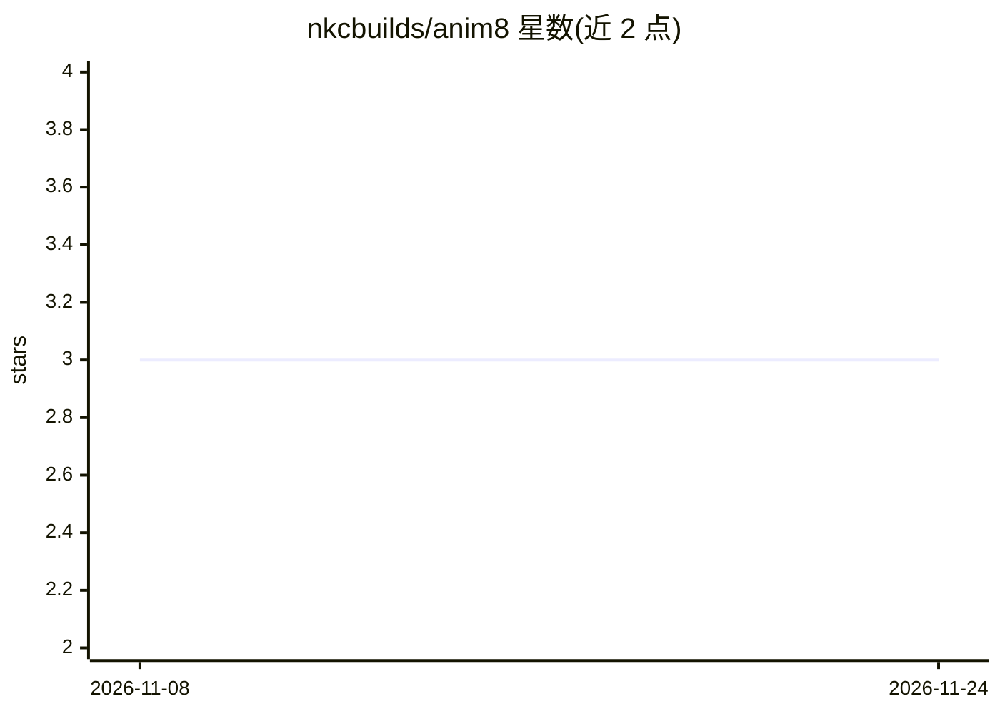

# nkcbuilds/anim8

⭐ 3 · TypeScript · MIT · 推送 2026-11-15 · [GitHub](https://github.com/nkcbuilds/anim8) · 个人维护

**面向图解与技术讲解的可回放 2D 动画场景库**

以数据形式创作带时间线的动画图示：用 TypeScript 或 JSON 描述场景，经编译校验后由 evaluator 在任意时间点求值，同一场景可播放、倒放、逐帧跳转、嵌入网页或导出为 SVG/GIF/MP4。面向需要讲解系统与算法的开发者和作者。提供 17 个图示家族与 150 个教学场景，支持 React/Vue/web component 嵌入及 Dagre/ELK 布局适配。预 1.0 阶段，npm 公开发布尚未上线，需从源码工作区运行；不提供 3D、物理或完整可视化编辑器。

## 筛选速览

| 维度 | 判定 | 备注 |
|---|---|---|
| AI 角色 | `ai-enhanced` | 去掉 AI 部分产品仍成立 |
| 许可风险 | `permissive` | MIT |
| 部署形态 | `library` | 以包/库形式分发 |
| 模型依赖 | — | README 未给出锁定关系 |
| 硬件要求 | — | 无带数字的原话,不猜 |
| 安装摩擦 | `medium` | 含编译或系统依赖之一 |
| 成熟度 | `idea` | |

## 能力要点

- 场景即数据：TypeScript/JSON 创作，支持校验、保存与复用
- 同一场景可播放、seek、倒放并导出 SVG/GIF/MP4
- 连接器绑定对象边缘，对象移动时保持连接
- 提供 DSL、agent 指南与创作技能用于文本创作

## 适用场景

- 制作可逐帧探索的算法与系统讲解动画
- 在 React/Vue 应用中嵌入可交互的动画图示
- 将导入的 JSON 场景校验后渲染为静态 SVG 帧

## 场景标签

 · 领域:开发者工具/可视化

## 证据(README 行号)

> L18: **The goal: make explanations people can explore.** Turn a system, algorithm, or process into a reusable scene, wit
> L131: |**Text authoring or agents**|DSL, agent guide, and authoring skill.|
> L199: It does not provide a 3D engine, physics, voice-over production, mathematical typesetting, or a full visual scene 

## 星数曲线

2026-11-08 3 → 2026-11-24 3（+0）

---
*卡片 v1 · prompt 1.4 · 生成 2026-11-21 · 置信度 mid · 依据 README sha `8cca963a6281` · [字段定义](../../DATASET.md)*
