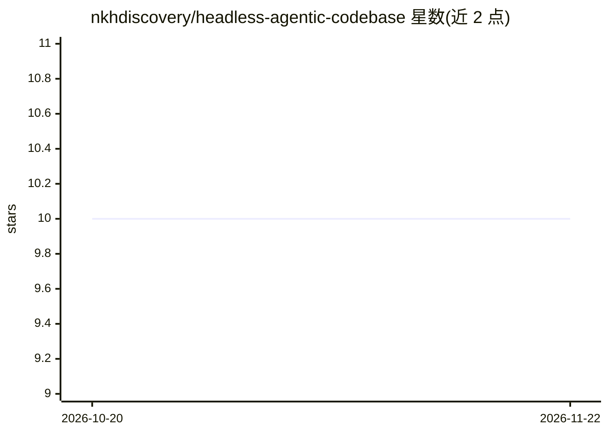

# nkhdiscovery/headless-agentic-codebase

⭐ 10 · Shell · MIT · 推送 2026-05-03 · [GitHub](https://github.com/nkhdiscovery/headless-agentic-codebase) · [官网](https://github.com/nkhdiscovery/headless-agentic-codebase/blob/main/GETTING_STARTED.md) · 个人维护

**让 coding agent 7x24 容器隔离运行并自动开 PR 的项目模板**

一个 drop-in 模板仓库，用于在项目上持续运行 Claude Code、Gemini CLI 或 Codex 等编码 agent：用户提交 issue 后，agent 每 10 分钟一个循环，取 issue、分支、先写测试再实现、跑 make ci、绿色即自合并并更新进度日志。治理机制包括常载指令 CLAUDE.md、无人值守规则文档、Docker 容器隔离、仅限 Makefile 命令面、硬限制清单（禁直推 main、禁 force-push 等）与 docs-gate 文档同步检查。支持多项目并行、经 GitHub 移动端异步遥控，并可从手机粘贴 bootstrap 提示词生成新项目骨架。

## 筛选速览

| 维度 | 判定 | 备注 |
|---|---|---|
| AI 角色 | `ai-ecosystem` | LLM/agent 周边工具 |
| 许可风险 | `permissive` | MIT |
| 部署形态 | `self-host` | docker 或自建部署 |
| 模型依赖 | — | README 未给出锁定关系 |
| 硬件要求 | — | 无带数字的原话,不猜 |
| 安装摩擦 | `low` | 无编译、无系统依赖或容器化 |
| 成熟度 | — | 结构信号不足 |

## 能力要点

- runtime-agnostic 启动循环：Claude/Gemini/Codex 一改配置即切换，支持 agents/custom.sh 自定义接入
- 三层治理：CLAUDE.md 常载指令、无人值守规则、Docker 隔离 + CI 门禁 + 硬限制
- 自合并工作流：10 分钟循环，issue→分支→测试→PR→绿色自合并→日志
- docs-gate 强制代码改动同步更新 per-module 文档；手机端 bootstrap 新项目

## 适用场景

- 让 agent 整夜/周末无人值守地为我的项目实现 issue
- 在手机上通过 GitHub PR 评论随时调整 agent 方向
- 一台主机并行跑多个项目的 agent，互不干扰
- 从手机零电脑环境起步 scaffold 一个新项目

## 场景标签

`编码 Agent` · 领域:编码与开发

## 证据(README 行号)

> L3: **A drop-in template for running an autonomous coding agent (Claude Code, Gemini CLI, Codex, etc.) 24/7 on your proj
> L11: This repo is the infrastructure that makes that work safely: **runtime-agnostic** orchestration (Claude, Gemini, Co
> L121: Every 10 minutes the agent runs one cycle:

## 星数曲线

2026-10-20 10 → 2026-11-22 10（+0）

---
*卡片 v1 · prompt 1.4 · 生成 2026-11-19 · 置信度 mid · 依据 README sha `f87a04f43824` · [字段定义](../../DATASET.md)*
