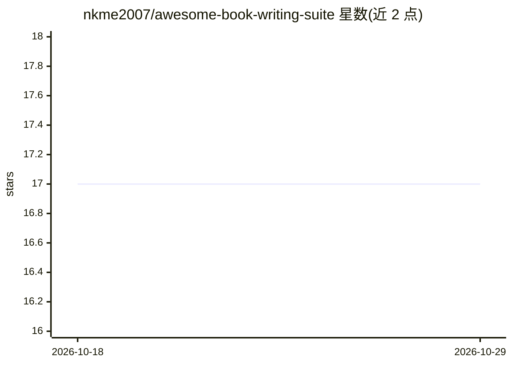

# nkme2007/awesome-book-writing-suite

⭐ 17 · MIT · 推送 2026-04-15 · [GitHub](https://github.com/nkme2007/awesome-book-writing-suite) · 个人维护

**面向作者的 Claude 图书写作工作室：12 个技能按流水线编排**

构建于 Claude Projects 之上的图书写作技能套件：PROJECT_INSTRUCTIONS.md 作为编排器，调度 12 个技能文件覆盖从选题压力测试、写作声音校准、章节架构、章节草稿，到红队审读、Beta 读者模拟、编辑润色、出版资产生成与内容再利用的完整流程；其中 4 个技能组成逐章重复的审读-润色循环。使用方式为在 claude.ai 新建 Project 并粘贴编排文件、上传技能文件；也可单独上传个别技能按提示词触发。

## 筛选速览

| 维度 | 判定 | 备注 |
|---|---|---|
| AI 角色 | `ai-knowledge` | 知识聚合/清单类 |
| 许可风险 | `permissive` | MIT |
| 部署形态 | `desktop` | 安装包/桌面程序 |
| 模型依赖 | locked-api |  |
| 硬件要求 | — | 无带数字的原话,不猜 |
| 安装摩擦 | `low` | 无编译、无系统依赖或容器化 |
| 成熟度 | — | 结构信号不足 |

## 能力要点

- 12 个技能覆盖选题→写作→审读→发布→内容再利用全流程
- PROJECT_INSTRUCTIONS.md 单文件编排技能调用与跨会话进度跟踪
- 审读循环：草稿→红队→Beta 读者→读者旅程→编辑，逐章重复
- 技能可整套或单独上传至 Claude Project 使用

## 适用场景

- 作为作者，让 AI 按统一流程帮我完成从想法到成书的全过程
- 在发布前用红队与 Beta 读者模拟审读章节
- 把已出版图书转化为社交媒体与课程内容

## 场景标签

`AI 写作` `提示工程` · 领域:Agent 开发

## 证据(README 行号)

> L3: A complete Claude-powered Book Writing Studio — 12 skills orchestrated by a single project prompt that takes an auth
> L9: This is not just a collection of skills. It is a **fully orchestrated studio system** built on Claude Projects.
> L11: The `PROJECT_INSTRUCTIONS.md` file acts as the conductor — it knows which skill to invoke at each stage, how to han

## 星数曲线

2026-10-18 17 → 2026-10-29 17（+0）

---
*卡片 v1 · prompt 1.4 · 生成 2026-10-29 · 置信度 high · 依据 README sha `c0a09ed4e98b` · [字段定义](../../DATASET.md)*
