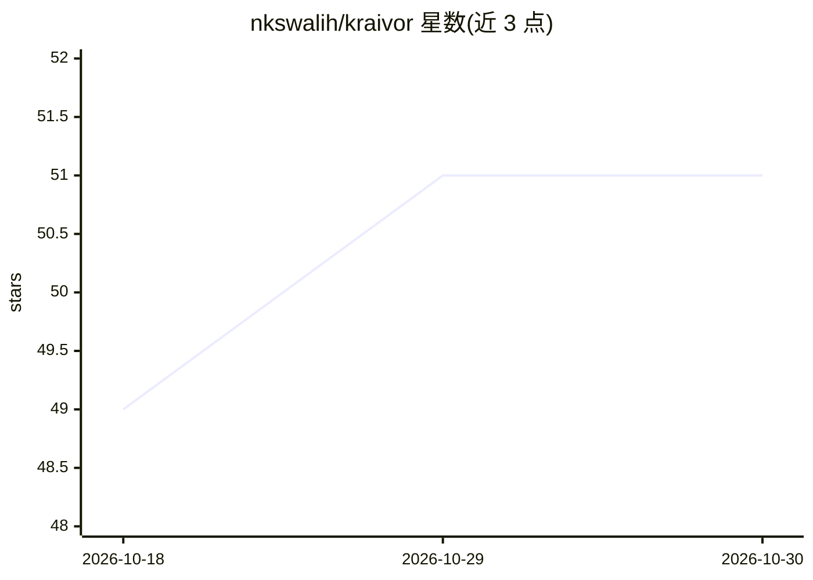

# nkswalih/kraivor

⭐ 51 · Python · MIT · 推送 2026-10-09 · [GitHub](https://github.com/nkswalih/kraivor) · 组织维护

**面向工程团队的开发者智能统一工作台：代码分析+多Agent AI+协作**

将仓库分析器、多 Agent AI 系统与开发者生产力平台整合到单一认证工作区。仓库分析生成生产就绪度评分与优先级修复报告；AI 服务（FastAPI）提供架构、安全、性能、代码生成等专职 Agent 协作并配备 RAG 管线；另有笔记、看板与实时协作。采用服务导向架构（Nginx/Kong 网关、Kafka 事件、Celery），后端 Django DRF/FastAPI/Node.js，前端 Next.js 15。需 Docker、Python 3.11+、Node 18+、PostgreSQL、Redis、Kafka 等依赖。Notifications 服务仅为脚手架未实现；AI 服务测试覆盖率 14%。MIT 许可。

## 筛选速览

| 维度 | 判定 | 备注 |
|---|---|---|
| AI 角色 | `ai-ecosystem` | LLM/agent 周边工具 |
| 许可风险 | `permissive` | MIT |
| 部署形态 | `self-host` | docker 或自建部署 |
| 模型依赖 | — | README 未给出锁定关系 |
| 硬件要求 | — | 无带数字的原话,不猜 |
| 安装摩擦 | `low` | 无编译、无系统依赖或容器化 |
| 成熟度 | — | 结构信号不足 |

## 能力要点

- 仓库结构分析并生成生产就绪度评分与修复报告
- 架构/安全/性能/代码生成多 Agent 协作，共享 RAG 上下文
- WebSocket 实时协作（聊天、在线状态、协同编辑）
- 服务导向架构：API 网关、Kafka 事件、每服务独立数据

## 适用场景

- 对代码库做安全、性能、可维护性的结构化分析
- 让多个专职 AI Agent 基于真实代码库协作评审
- 团队在同一工作区管理笔记、看板与仓库洞察

## 场景标签

`多智能体` `RAG` `代码审查` · 领域:Agent 开发

## 证据(README 行号)

> L15:  Kraivor is a unified developer intelligence platform that combines a Repository Analyzer , Agentic AI System , and
> L24: - **Multi-agent AI** — specialized agents for architecture review, security auditing, performance profiling, and co
> L92: |AI|`8004`|FastAPI|Multi-Agent AI, RAG Pipeline|

## 星数曲线

2026-10-18 49 → 2026-10-30 51（+2）

---
*卡片 v1 · prompt 1.4 · 生成 2026-10-24 · 置信度 high · 依据 README sha `08696501c28b` · [字段定义](../../DATASET.md)*
