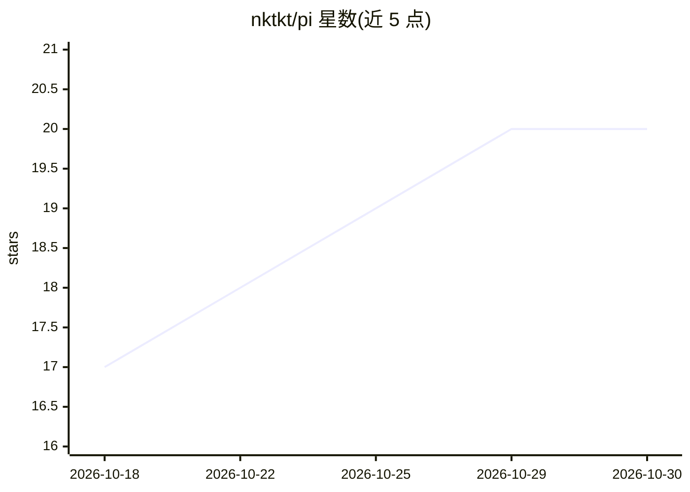

# nktkt/pi

⭐ 20 · Rust · MIT · 推送 2026-05-12 · [GitHub](https://github.com/nktkt/pi) · 个人维护

**Rust 版 pi 编码代理框架：多厂商 LLM API + agent 运行时 + CLI**

earendil-works/pi（TypeScript 单体仓库）的 Rust 移植，覆盖 agent 运行时、多厂商流式 LLM API 与 CLI：pi-ai 支持 Anthropic/OpenAI/Google 的 SSE 流式、Retry-After 重试与任意 OpenAI 兼容端点透传；pi-agent 提供带逐工具权限门的流式 run_agent 循环与 9 个内置工具（read/write/edit/bash 等）；pi-coding-agent 输出可交互的 pi CLI，含会话持久化与 --resume、AGENTS.md/CLAUDE.md 加载。以 crates.io 库与 cargo 安装的二进制形式提供给 Rust 开发者与终端用户。未移植上游的 TUI 与 Web UI。

## 筛选速览

| 维度 | 判定 | 备注 |
|---|---|---|
| AI 角色 | `ai-native` | 本体是模型或模型工具 |
| 许可风险 | `permissive` | MIT |
| 部署形态 | `library` | 以包/库形式分发 |
| 模型依赖 | locked-api |  |
| 硬件要求 | — | 无带数字的原话,不猜 |
| 安装摩擦 | `medium` | 含编译或系统依赖之一 |
| 成熟度 | — | 结构信号不足 |

## 能力要点

- pi-ai 多厂商 SSE 流式 API，含 OpenAI 兼容端点透传（OpenRouter/Groq 等）
- pi-agent 流式代理循环，含逐工具权限门与 read/write/bash 等 9 个内置工具
- pi CLI：print 模式、交互 REPL、会话持久化与 --resume
- 运行时库以 pi-ai/pi-agent 名义发布到 crates.io 供复用

## 适用场景

- 在终端里通过多轮代理循环完成编码任务
- 在 Rust 项目中复用厂商无关的流式 LLM API 与代理运行时
- 通过 OpenAI 兼容端点接入 OpenRouter、Groq、DeepSeek 等服务

## 场景标签

`编码 Agent` `Agent 框架` · 领域:Agent 开发

## 证据(README 行号)

> L13: the agent runtime, multi-provider LLM API, and CLI end-to-end and ships a
> L31: |`@earendil-works/pi-agent-core`|`pi-agent`|Streaming `run_agent` loop with per-tool permission gate, typed `AgentE
> L32: |`@earendil-works/pi-coding-agent`|`pi-coding-agent`|`pi` CLI: print mode (`-p`), interactive REPL with streaming r

## 星数曲线

2026-10-18 17 → 2026-10-30 20（+3）

---
*卡片 v1 · prompt 1.4 · 生成 2026-10-28 · 置信度 high · 依据 README sha `f419cc04952c` · [字段定义](../../DATASET.md)*
