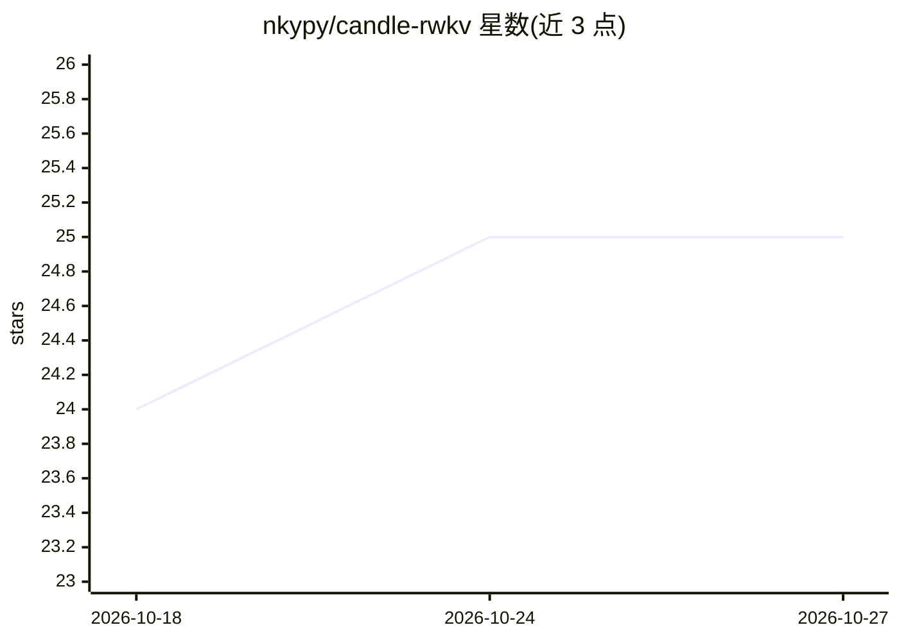

# nkypy/candle-rwkv

⭐ 25 · Rust · 推送 2026-01-19 · [GitHub](https://github.com/nkypy/candle-rwkv) · [官网](https://github.com/nkypy/candle-rwkv) · 个人维护 · 中文 README

**Rust 实现 RWKV5/6/7 模型推理与量化转换工具**

基于 Candle（Rust 轻量深度学习框架）实现的 RWKV 模型库，支持 RWKV7(Goose)/RWKV6(Finch)/RWKV5(Eagle) 的命令行推理，并提供 --quantized 选项做内存节省的量化推理。附带工具链：将 HuggingFace 下载的 PyTorch .pth 权重与 state 文件转换为 SafeTensors 以本地运行，以及转换 .pth 到 GGUF 格式的量化工具。通过 cargo 以示例程序方式运行，面向 Rust 开发者与 RWKV 模型使用者。

## 筛选速览

| 维度 | 判定 | 备注 |
|---|---|---|
| AI 角色 | `ai-native` | 本体是模型或模型工具 |
| 许可风险 | `none` | — |
| 部署形态 | `None` |  |
| 模型依赖 | — | README 未给出锁定关系 |
| 硬件要求 | — | 无带数字的原话,不猜 |
| 安装摩擦 | `low` | 无编译、无系统依赖或容器化 |
| 成熟度 | — | 结构信号不足 |

## 能力要点

- 支持 RWKV7/6/5 三代模型的命令行推理
- 内置 --quantized 量化推理选项
- .pth→SafeTensors 权重与 state 转换工具，支持本地模型文件运行
- .pth→GGUF 格式转换工具

## 适用场景

- 在 Rust 环境直接运行 RWKV 模型推理
- 将 HuggingFace 上的 RWKV 权重转为 SafeTensors 后本地部署
- 把 RWKV 模型转换为 GGUF 格式以便量化使用

## 场景标签

`推理引擎` `模型量化` · 领域:训练与推理

## 证据(README 行号)

> L3: > **A minimalist, high-performance implementation of RWKV (Receptance Weighted Key Value) models using Candle - a li
> L27: cargo run --release --example rwkv -- --which "v7-0b1" --prompt "User: why is the sky blue?\n\nAssistant: "

## 星数曲线

2026-10-18 24 → 2026-10-27 25（+1）

---
*卡片 v1 · prompt 1.4 · 生成 2026-10-27 · 置信度 high · 依据 README sha `da95619696ea` · [字段定义](../../DATASET.md)*
