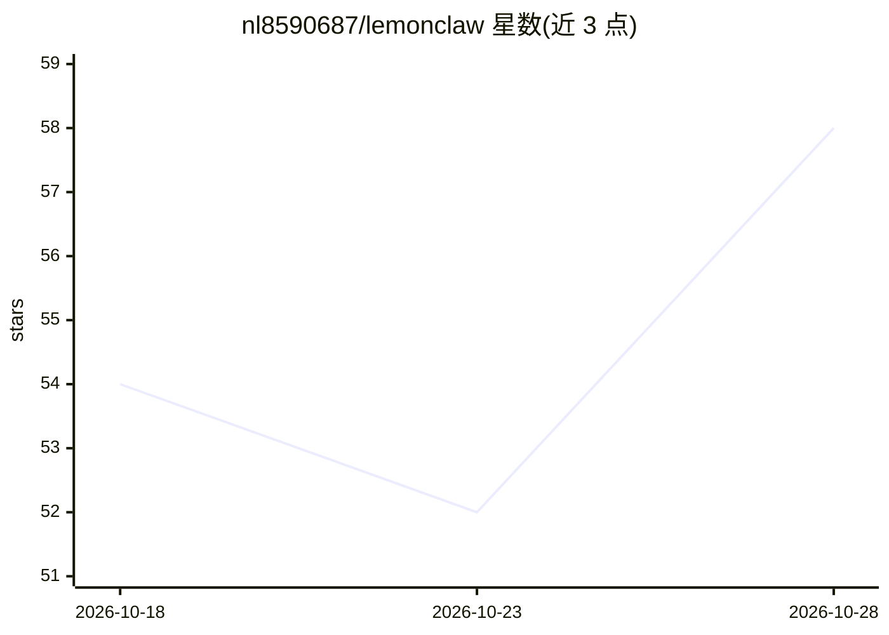

# nl8590687/lemonclaw

⭐ 58 · Python · Apache-2.0 · 推送 2026-10-25 · [GitHub](https://github.com/nl8590687/lemonclaw) · 个人维护 · 中文 README

**开源通用 AI 数字员工 Agent 框架，多渠道接入任意 LLM**

Python 编写的通用 AI Agent 框架，把任意 OpenAI 兼容 LLM 变成可通过终端、Webhook、飞书、定时任务多渠道对话的数字员工。核心机制包括 ReAct 循环、16+ 内置工具（文件/git/web/邮件/shell 等）、TF-IDF 持久记忆、OpenClaw 兼容的技能包热加载、MCP 客户端接入与 LangGraph 多 Agent 工作流，数据统一存于单个 SQLite。限制：MCP 仅支持 Streamable HTTP（不支持 stdio），bash 与技能脚本默认关闭。提供 Docker 镜像与源码安装两种部署方式。

## 筛选速览

| 维度 | 判定 | 备注 |
|---|---|---|
| AI 角色 | `ai-ecosystem` | LLM/agent 周边工具 |
| 许可风险 | `permissive` | Apache-2.0 |
| 部署形态 | `self-host` | docker 或自建部署 |
| 模型依赖 | — | README 未给出锁定关系 |
| 硬件要求 | — | 无带数字的原话,不猜 |
| 安装摩擦 | `low` | 无编译、无系统依赖或容器化 |
| 成熟度 | — | 结构信号不足 |

## 能力要点

- 多渠道接入：终端/Webhook/飞书/Cron 统一消息总线
- 16+ 内置工具与可热加载的 OpenClaw 兼容技能包
- 基于 LangGraph 的声明式多 Agent 工作流，支持 HITL 与断点续跑
- MCP 客户端接入外部工具，SQLite 单库持久化记忆与会话

## 适用场景

- 部署一个可从飞书或 Webhook 对话的私人 AI 助手
- 让 Agent 定时执行任务并跨会话保留记忆
- 通过 SKILL.md 技能包与 MCP 服务器扩展 Agent 能力

## 场景标签

`Agent 框架` `多智能体` · 领域:Agent 开发

## 证据(README 行号)

> L12: LemonClaw is an open-source, general-purpose AI agent framework that turns any LLM into a "digital employee" you ca
> L21: - 🔀 **Multi-Agent Workflow** — build and run LangGraph-based multi-agent workflows with declarative JSON specs; sub

## 星数曲线

2026-10-18 54 → 2026-10-28 58（+4）

---
*卡片 v1 · prompt 1.4 · 生成 2026-10-24 · 置信度 high · 依据 README sha `583cdeb26086` · [字段定义](../../DATASET.md)*
