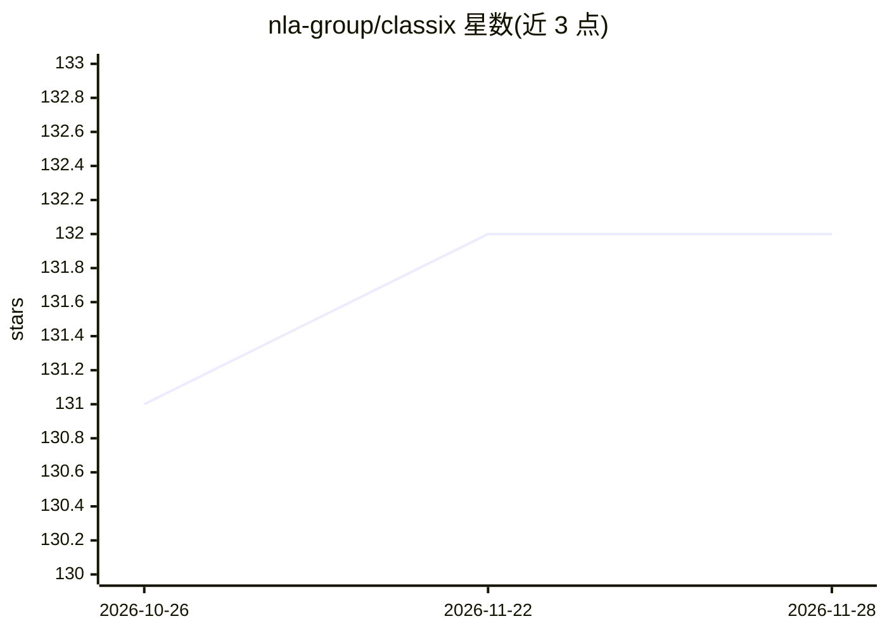

# nla-group/classix

⭐ 132 · Python · MIT · 推送 2026-11-24 · [GitHub](https://github.com/nla-group/classix) · [官网](https://classix.readthedocs.io/) · 组织维护

**Python 快速可解释聚类库，输出带解释的聚类结果**

CLASSIX（CLustering by Aggregation with Sorting-based Indexing）是一个 Python 聚类算法库：先按第一主轴排序并聚合数据点形成分组，再将分组合并为簇；radius 控制分组大小、minPts 控制最小簇规模，支持 minPtsChange 复用已拟合结果做二次调参。提供 explain 方法生成文字与图形解释，说明数据点归入某簇的路径与原因，并支持对样本外数据的 predict()。依赖 NumPy/SciPy/Pandas/Matplotlib，可选 Cython 编译加速，提供 PyPI 与 conda-forge 安装。

## 筛选速览

| 维度 | 判定 | 备注 |
|---|---|---|
| AI 角色 | `ai-native` | 本体是模型或模型工具 |
| 许可风险 | `permissive` | MIT |
| 部署形态 | `library` | 以包/库形式分发 |
| 模型依赖 | — | README 未给出锁定关系 |
| 硬件要求 | — | 无带数字的原话,不猜 |
| 安装摩擦 | `low` | 无编译、无系统依赖或容器化 |
| 成熟度 | — | 结构信号不足 |

## 能力要点

- 两阶段算法：排序聚合成分组，再合并为簇
- explain 方法提供文字与可视化聚类解释
- minPtsChange 复用拟合结果，调参无需从头重算
- 支持 Euclidean、Tanimoto、Manhattan 距离与 Cython 加速

## 适用场景

- 对高维或任意形状数据做无监督聚类
- 需要向他人解释为何两个数据点归入同一簇
- 复现论文中的聚类实验结果

## 场景标签

 · 领域:机器学习/数据挖掘

## 证据(README 行号)

> L19: __CLASSIX__ is a fast, memory-efficient, and explainable clustering algorithm. Here are a few highlights:
> L96: CLASSIX clustering consists of two phases, namely a greedy aggregation phase of the data into groups of nearby data

## 星数曲线

2026-10-26 131 → 2026-11-28 132（+1）

---
*卡片 v1 · prompt 1.4 · 生成 2026-11-28 · 置信度 high · 依据 README sha `c80a090309f5` · [字段定义](../../DATASET.md)*
