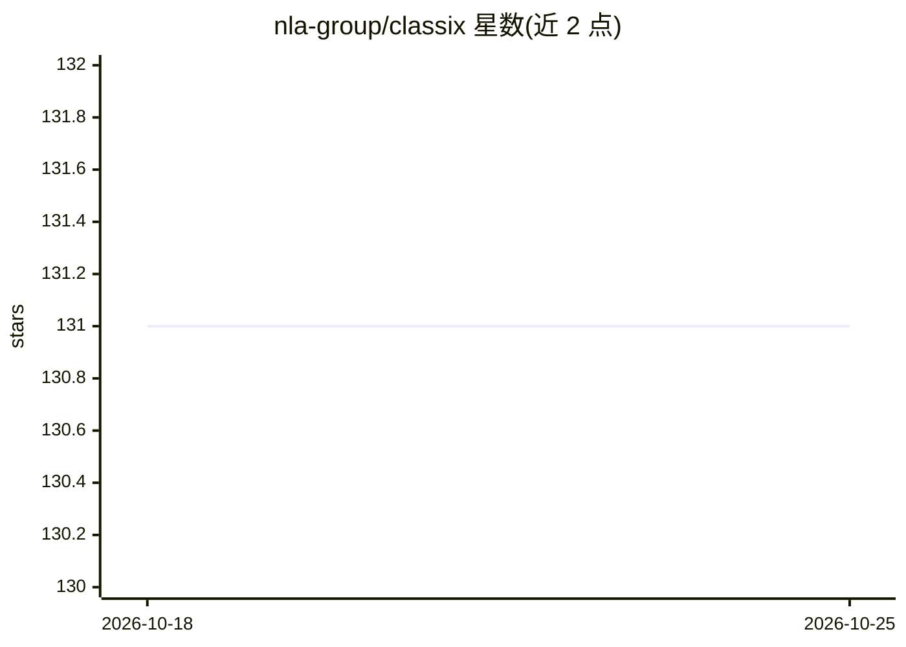

# nla-group/classix

⭐ 131 · Python · MIT · 推送 2026-10-25 · [GitHub](https://github.com/nla-group/classix) · [官网](https://classix.readthedocs.io/) · 组织维护

**面向数据分析师的可解释快速聚类 Python 库**

CLASSIX 是一个聚类算法实现：先沿第一主轴排序数据点，将其聚合为半径 radius 的组，再将组合并为簇，最后把小于 minPts 的簇重新分配到较大簇。支持任意形状的低维/高维数据、离群点处理、Euclidean/Tanimoto/Manhattan 距离，以及基于 Cython 的加速编译（缺失时回退纯 Python，速度可能下降）。提供 explain 方法以文本和可视化解释聚类结果及两数据点是否同簇的原因，支持 DataFrame 索引引用数据点。以 pip/conda 安装的 Python 库形式提供，论文实验可通过 exps 目录复现。

## 筛选速览

| 维度 | 判定 | 备注 |
|---|---|---|
| AI 角色 | `ai-native` | 本体是模型或模型工具 |
| 许可风险 | `permissive` | MIT |
| 部署形态 | `library` | 以包/库形式分发 |
| 模型依赖 | — | README 未给出锁定关系 |
| 硬件要求 | — | 无带数字的原话,不猜 |
| 安装摩擦 | `low` | 无编译、无系统依赖或容器化 |
| 成熟度 | — | 结构信号不足 |

## 能力要点

- 排序+聚合+合并两阶段聚类，支持任意形状高低维数据
- explain 方法提供文本与可视化的聚类解释（含数据点同/异簇路径说明）
- 支持 Euclidean、Tanimoto、Manhattan 距离
- Cython 加速可选，无 C 编译器时回退纯 Python 运行

## 适用场景

- 对高维或任意形状数据做可解释的聚类分析
- 向他人解释两个数据点为何被分到同一或不同簇
- 检测并处理数据中的离群点与噪声簇
- 复现配套论文中的聚类实验

## 场景标签

`数据分析` · 领域:效率与自动化

## 证据(README 行号)

> L19: __CLASSIX__ is a fast, memory-efficient, and explainable clustering algorithm. Here are a few highlights:
> L96: CLASSIX clustering consists of two phases, namely a greedy aggregation phase of the data into groups of nearby data
> L172: Please refer to the CLASSIX paper referenced below. In short, CLASSIX sorts the data points along their first prin

## 星数曲线

2026-10-18 131 → 2026-10-25 131（+0）

---
*卡片 v1 · prompt 1.4 · 生成 2026-10-22 · 置信度 high · 依据 README sha `a4a12e8c9944` · [字段定义](../../DATASET.md)*
