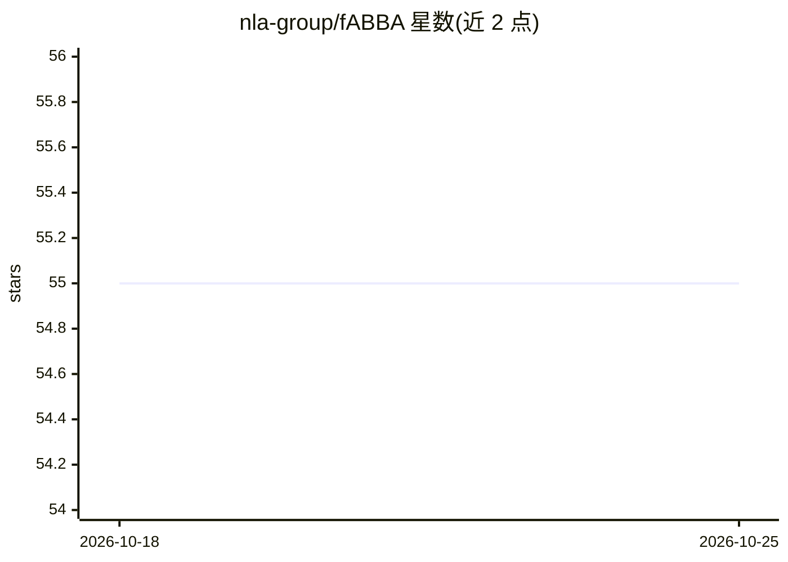

# nla-group/fABBA

⭐ 55 · Python · BSD-3-Clause · 推送 2026-09-26 · [GitHub](https://github.com/nla-group/fABBA) · 组织维护

**时间序列快速符号化近似库：压缩、降维与重构**

Python 库，实现 ABBA 系列符号时间序列近似方法：先将时间序列压缩为多边形链，再聚合成符号组，可逆重构数值序列。包含 fABBA（排序加速、容差驱动、无需预设符号数）、原始 ABBA（可搭配 scikit-learn KMeans）、JABBA（多序列/多变量共享码本）、QABBA/XABBA（量化与定点变体），并支持图像数据压缩。符号化是有损的：tol 约束多边形压缩误差而非最终重构 RMSE。提供 pip/conda-forge 安装，发布覆盖多平台预编译 wheel，另有 C++ 实现仓库 cabba。

## 筛选速览

| 维度 | 判定 | 备注 |
|---|---|---|
| AI 角色 | `ai-native` | 本体是模型或模型工具 |
| 许可风险 | `permissive` | BSD-3-Clause |
| 部署形态 | `library` | 以包/库形式分发 |
| 模型依赖 | — | README 未给出锁定关系 |
| 硬件要求 | — | 无带数字的原话,不猜 |
| 安装摩擦 | `medium` | 含编译或系统依赖之一 |
| 成熟度 | — | 结构信号不足 |

## 能力要点

- fABBA 通过排序与提前终止加速聚合，容差驱动、无需预设符号数
- 提供 ABBA/JABBA/QABBA/XABBA 多变体 API 与码本 JSON 导出
- 支持多平台预编译 wheel（macOS/Linux/Windows 多架构）与 C 编译器免装模式
- 可应用于时间序列压缩、聚类、分类及图像压缩

## 适用场景

- 把长序列转为符号表示做压缩或降维
- 为聚类/分类任务生成符号特征（含多序列共享码本）
- 学术论文实验复现（附 UCR 数据集实验代码）

## 场景标签

 · 领域:时间序列分析/机器学习

## 证据(README 行号)

> L43: The ABBA methods provide a fast and accurate symbolic approximation of temporal data, making them well-suited for t
> L45: The ``fABBA`` library supports multiple ABBA variants, including the original ABBA method and the optimized fABBA a

## 星数曲线

2026-10-18 55 → 2026-10-25 55（+0）

---
*卡片 v1 · prompt 1.4 · 生成 2026-10-24 · 置信度 high · 依据 README sha `30259e7b578c` · [字段定义](../../DATASET.md)*
