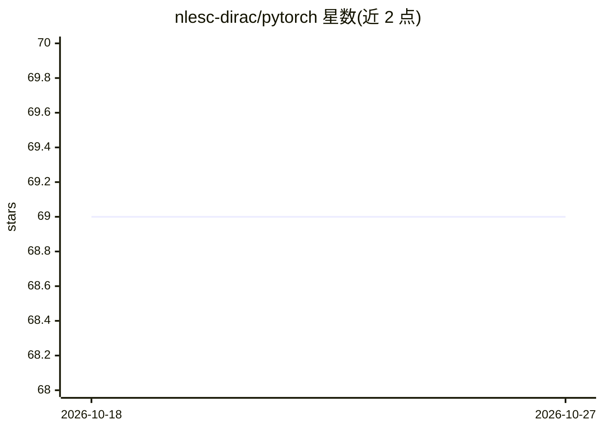

# nlesc-dirac/pytorch

⭐ 69 · Python · Apache-2.0 · 推送 2026-08-01 · [GitHub](https://github.com/nlesc-dirac/pytorch) · 组织维护

**PyTorch 的改进 LBFGS/LBFGS-B 优化器实现**

面向深度学习研究者的 PyTorch 优化器代码库，提供 LBFGSNew 与带边界约束的 LBFGS-B 两个优化器文件，支持全批次与小批次两种模式及 line search 选项；针对梯度计入代价（如 TV 正则化）的场景提供 cost_use_gradient 选项。附 CIFAR10 ResNet 训练与 Kolmogorov Arnold 网络 PDE 示例；README 给出与 Adam 的训练损失/测试精度对比数据，并链接联邦学习、射电干涉校准、K-harmonic 均值聚类等应用论文。

## 筛选速览

| 维度 | 判定 | 备注 |
|---|---|---|
| AI 角色 | `ai-ecosystem` | LLM/agent 周边工具 |
| 许可风险 | `permissive` | Apache-2.0 |
| 部署形态 | `None` |  |
| 模型依赖 | — | README 未给出锁定关系 |
| 硬件要求 | — | 无带数字的原话,不猜 |
| 安装摩擦 | `low` | 无编译、无系统依赖或容器化 |
| 成熟度 | — | 结构信号不足 |

## 能力要点

- 提供 LBFGSNew 与 LBFGS-B（带边界约束）两个优化器
- 支持全批次与小批次模式及 line search
- cost_use_gradient 选项支持梯度计入代价的问题（如 TV 正则化）
- 附 CIFAR10 ResNet 与 KAN 求解 PDE 示例代码

## 适用场景

- 在 PyTorch 训练中以 LBFGS 替代其他优化器
- 带边界约束的非线性优化问题
- KAN 求解偏微分方程等科研实验

## 场景标签

 · 领域:深度学习/优化

## 证据(README 行号)

> L2: An improved LBFGS (and LBFGS-B) optimizer for PyTorch is provided with the code. Further details are given in this p
> L16: ``` lbfgsnew.py ```: New LBFGS optimizer
> L18: ``` lbfgsb.py ```: LBFGS-B optimizer (with bound constraints)

## 星数曲线



2026-10-18 69 → 2026-10-27 69（+0）


---
*卡片 v1 · prompt 1.4 · 生成 2026-10-24 · 置信度 high · 依据 README sha `cae6784c7668` · [字段定义](../../DATASET.md)*
