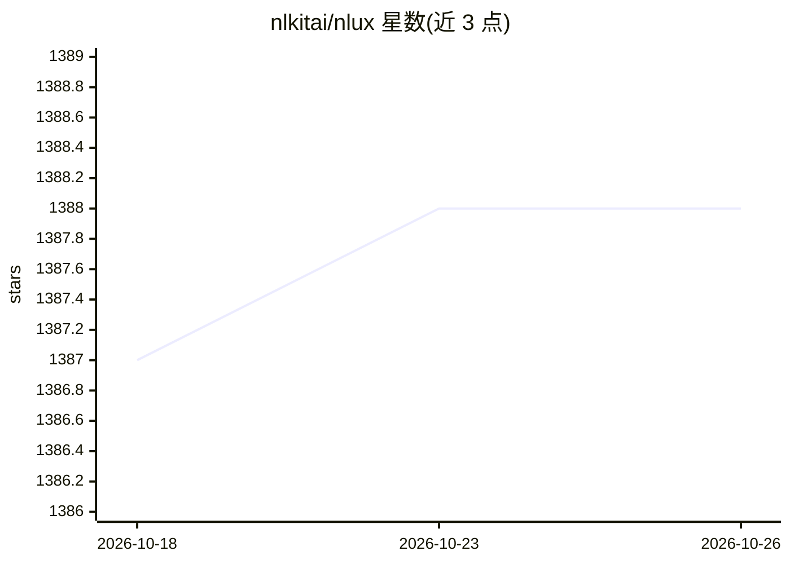

# nlkitai/nlux

⭐ 1,388 · TypeScript · NOASSERTION · 推送 2026-10-14 · [GitHub](https://github.com/nlkitai/nlux) · [官网](https://docs.nlkit.com/nlux) · 个人维护

**构建 LLM 对话界面的 React/JavaScript 前端组件库**

NLUX 是面向开发者的开源 React 与原生 JavaScript 库，用于为任意 LLM 构建对话式 AI 网页界面：提供 <AiChat /> 组件、useChatAdapter 钩子、助手/用户人设、主题定制与 Markdown 流式渲染等能力；内置 ChatGPT、LangChain LangServe、Hugging Face Inference 的适配器，也可自定义适配器接入任意 LLM，支持流式与批处理模式。以 monorepo 形式发布多个 npm 包，可用 nlux-cli 快速创建 Next.js/React/原生 TS 项目。核心包零依赖。许可为 MPL 2.0 附加条款（禁止用作 AI 训练数据集或代码翻译工具输入）。

## 筛选速览

| 维度 | 判定 | 备注 |
|---|---|---|
| AI 角色 | `ai-ecosystem` | LLM/agent 周边工具 |
| 许可风险 | `none` | NOASSERTION |
| 部署形态 | `library` | 以包/库形式分发 |
| 模型依赖 | — | README 未给出锁定关系 |
| 硬件要求 | — | 无带数字的原话,不猜 |
| 安装摩擦 | `low` | 无编译、无系统依赖或容器化 |
| 成熟度 | — | 结构信号不足 |

## 能力要点

- 提供 <AiChat /> 组件与 useChatAdapter 钩子构建对话界面
- 适配 ChatGPT / LangChain LangServe / Hugging Face Inference，并支持自定义适配器
- 支持 React Server Components 与 Generative UI（Next.js）
- 核心包零依赖，monorepo 形式发布多个 npm 包

## 适用场景

- 在 React 或 Next.js 应用中快速添加 LLM 聊天界面
- 通过 nlux-cli 生成带 NLUX 集成的新项目脚手架
- 自定义适配器接入任意 LLM API（流式或批处理）

## 场景标签

 · 领域:前端/LLM 界面组件

## 证据(README 行号)

> L17: `NLUX` is React and JavaScript open-source library for building conversational AI interfaces. It makes it super sim
> L140: Our mission is **to enable developers to build outstanding LLM front-ends and applications**,

## 星数曲线

2026-10-18 1,387 → 2026-10-26 1,388（+1）

---
*卡片 v1 · prompt 1.4 · 生成 2026-10-21 · 置信度 high · 依据 README sha `c825dcea19f0` · [字段定义](../../DATASET.md)*
