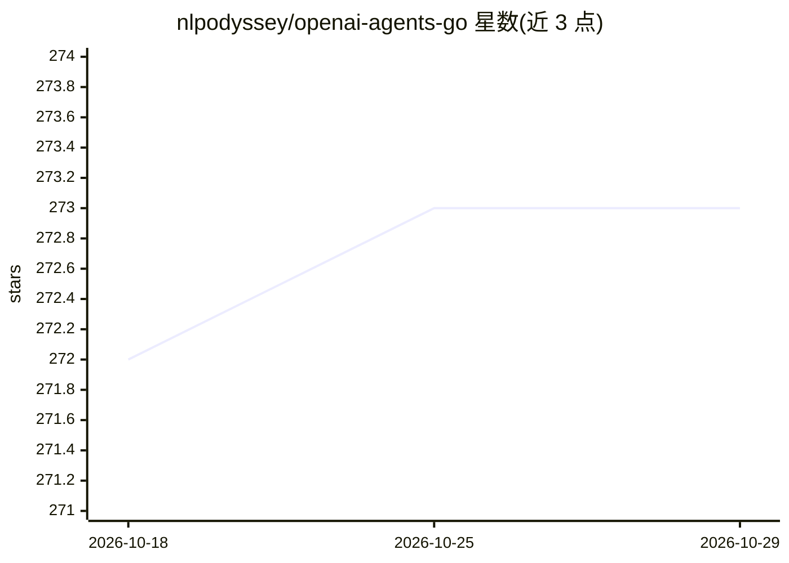

# nlpodyssey/openai-agents-go

⭐ 273 · Go · Apache-2.0 · 推送 2026-10-07 · [GitHub](https://github.com/nlpodyssey/openai-agents-go) · 组织维护

**给 Go 开发者的多 Agent 工作流框架（OpenAI Agents SDK 移植）**

OpenAI Agents Python SDK 的 Go 语言移植版，提供构建多 Agent 工作流的框架：Agent（带指令、工具、护栏与 handoff 的 LLM 配置）、Agent 循环（agents.Run() 迭代调用 LLM、处理工具调用与 handoff 直至产出最终输出）、结构化输出与 MaxTurns 限制。供应商无关，支持 OpenAI Responses 与 Chat Completions API 及其他 LLM，示例含 MCP、语音、会话记忆与自定义 model provider（如 LiteLLM）。需 Go 1.25+，非 OpenAI 官方项目，由社区维护。

## 筛选速览

| 维度 | 判定 | 备注 |
|---|---|---|
| AI 角色 | `ai-ecosystem` | LLM/agent 周边工具 |
| 许可风险 | `permissive` | Apache-2.0 |
| 部署形态 | `None` |  |
| 模型依赖 | — | README 未给出锁定关系 |
| 硬件要求 | — | 无带数字的原话,不猜 |
| 安装摩擦 | `low` | 无编译、无系统依赖或容器化 |
| 成熟度 | — | 结构信号不足 |

## 能力要点

- Agent/Handoff/Guardrail 核心概念与 agent 循环机制
- 供应商无关：支持 OpenAI Responses/Chat Completions 及其他 LLM
- MCP 服务器与客户端示例（文件系统、git、远程搜索等）
- 结构化输出（OutputType）与 MaxTurns 循环限制

## 适用场景

- 用 Go 构建多 Agent 协作的工作流（如客服、研究机器人）
- 为 Go 项目接入 OpenAI 或其他 LLM 的 Agent 能力
- 在 Agent 间用 handoff 转移控制权并用 guardrails 做输入输出校验

## 场景标签

`Agent 框架` `多智能体` · 领域:Agent 开发

## 证据(README 行号)

> L3: The OpenAI Agents SDK is a lightweight yet powerful framework for building
> L14: 1. **Agents**: LLMs configured with instructions, tools, guardrails, and handoffs

## 星数曲线

2026-10-18 272 → 2026-10-29 273（+1）

---
*卡片 v1 · prompt 1.4 · 生成 2026-10-22 · 置信度 high · 依据 README sha `e79f628b149c` · [字段定义](../../DATASET.md)*
