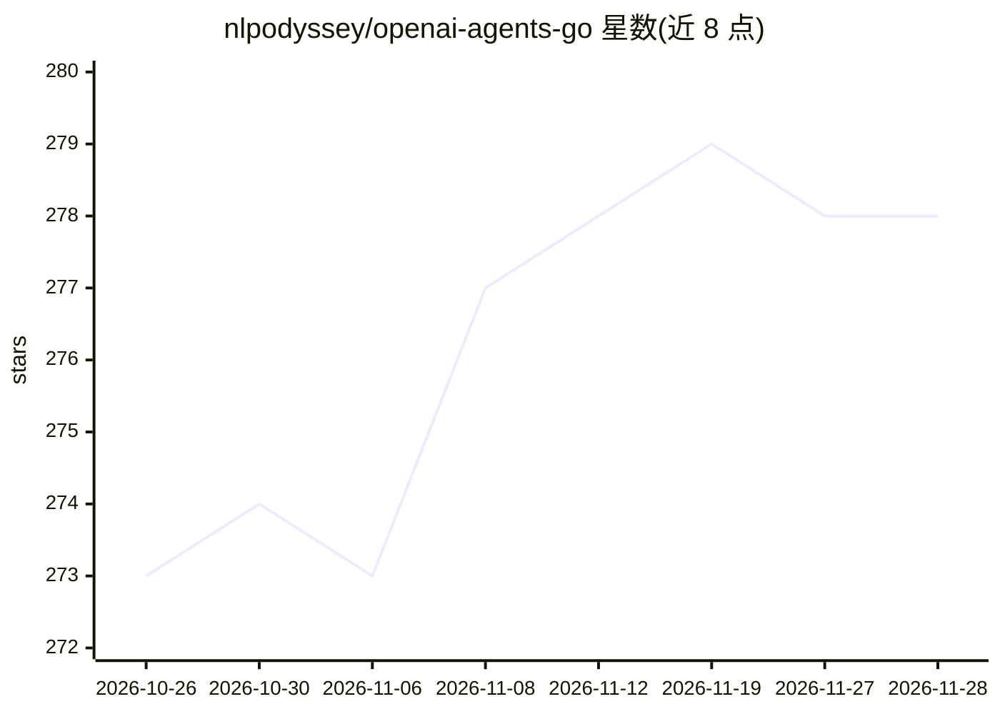

# nlpodyssey/openai-agents-go

⭐ 278 · Go · Apache-2.0 · 推送 2026-11-23 · [GitHub](https://github.com/nlpodyssey/openai-agents-go) · 组织维护

**Go 开发者的多 Agent 工作流编排框架**

OpenAI Agents Python SDK 的 Go 移植版，行为与 API 尽量贴近原实现。以 Agent（配置指令/工具/护栏/移交的 LLM）、Handoffs（Agent 间控制权移交）、Guardrails（输入输出校验）为核心概念，提供 agent loop 执行机制与结构化输出、流式输出、会话记忆、MCP 客户端/服务端、语音响应等能力。Provider-agnostic 设计，支持 OpenAI Responses 与 Chat Completions API 及其他 LLM。需要 Go 1.25+，示例需设置 OPENAI_API_KEY。

## 筛选速览

| 维度 | 判定 | 备注 |
|---|---|---|
| AI 角色 | `ai-ecosystem` | LLM/agent 周边工具 |
| 许可风险 | `permissive` | Apache-2.0 |
| 部署形态 | `None` |  |
| 模型依赖 | — | README 未给出锁定关系 |
| 硬件要求 | — | 无带数字的原话,不猜 |
| 安装摩擦 | `low` | 无编译、无系统依赖或容器化 |
| 成熟度 | — | 结构信号不足 |

## 能力要点

- Provider-agnostic：支持 OpenAI Responses/Chat Completions 及其他 LLM
- Agent loop 机制：工具调用、handoff、MaxTurns 循环上限、结构化输出
- MCP 客户端与服务端示例（文件系统、git、远程搜索等）
- 内置工具：代码解释器、computer use、文件搜索、网络搜索

## 适用场景

- 在 Go 服务中构建多 Agent 协作工作流
- 开发客服、金融研究等多 Agent 编排应用
- 为已有 Go 系统接入 LLM 与工具调用能力

## 场景标签

`Agent 框架` `多智能体` · 领域:Agent 开发

## 证据(README 行号)

> L3: The OpenAI Agents SDK is a lightweight yet powerful framework for building
> L7: This is a Go port of OpenAI Agents Python SDK
> L29: |model_providers|Integrating custom model providers and proxies like LiteLLM.|

## 星数曲线

2026-10-26 273 → 2026-11-28 278（+5）

---
*卡片 v1 · prompt 1.4 · 生成 2026-11-25 · 置信度 high · 依据 README sha `87ba7b02ddcb` · [字段定义](../../DATASET.md)*
