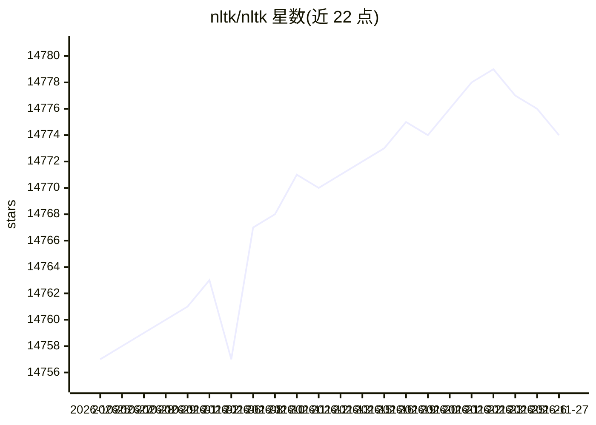

# nltk/nltk

⭐ 14,774 · Python · Apache-2.0 · 推送 2026-11-16 · [GitHub](https://github.com/nltk/nltk) · [官网](https://www.nltk.org) · 组织维护

**为 NLP 研究与开发提供 Python 模块、数据集与教程的工具包**

NLTK 是一套开源 Python 模块、数据集与教程的集合，支持自然语言处理的研究与开发，要求 Python 3.11 至 3.15。文档站点为 nltk.org，配套《Natural Language Processing with Python》一书可引用。代码采用 Apache 2.0 许可，文档采用 CC BY-NC-ND 3.0 许可，语料库按各自 README 条款分发、仅限非商业用途。项目由 NLTK Project 维护，贡献者名单见 AUTHORS.md。

## 筛选速览

| 维度 | 判定 | 备注 |
|---|---|---|
| AI 角色 | `ai-native` | 本体是模型或模型工具 |
| 许可风险 | `permissive` | Apache-2.0 |
| 部署形态 | `library` | 以包/库形式分发 |
| 模型依赖 | — | README 未给出锁定关系 |
| 硬件要求 | — | 无带数字的原话,不猜 |
| 安装摩擦 | `low` | 无编译、无系统依赖或容器化 |
| 成熟度 | — | 结构信号不足 |

## 动量与使用信号

- 维护:`active` — 距上次 push 0.9 天,年发版 8,368 位贡献者
- 涨星:近 1 天 **+2**(自 20261016 起算)

## 能力要点

- 提供模块、数据集（corpora）与教程三部分资源
- 要求 Python 3.11–3.15
- 代码 Apache 2.0、文档 CC BY-NC-ND 3.0 分许可
- 配有可引用的 NLTK Book

## 适用场景

- 搭建 Python 自然语言处理研究环境
- 教学中配合 NLTK 教程学习 NLP
- 为 NLP 开发获取可再分发的语料数据集

## 场景标签

`教程课程` · 领域:学习与行业

## 证据(README 行号)

> L5: NLTK -- the Natural Language Toolkit -- is a suite of open source Python
> L6: modules, data sets, and tutorials supporting research and development in Natural

## 星数曲线

2026-10-25 14,757 → 2026-11-27 14,774（+17）

---
*卡片 v1 · prompt 1.4 · 生成 2026-11-22 · 置信度 high · 依据 README sha `b8a53aea8468` · [字段定义](../../DATASET.md)*
