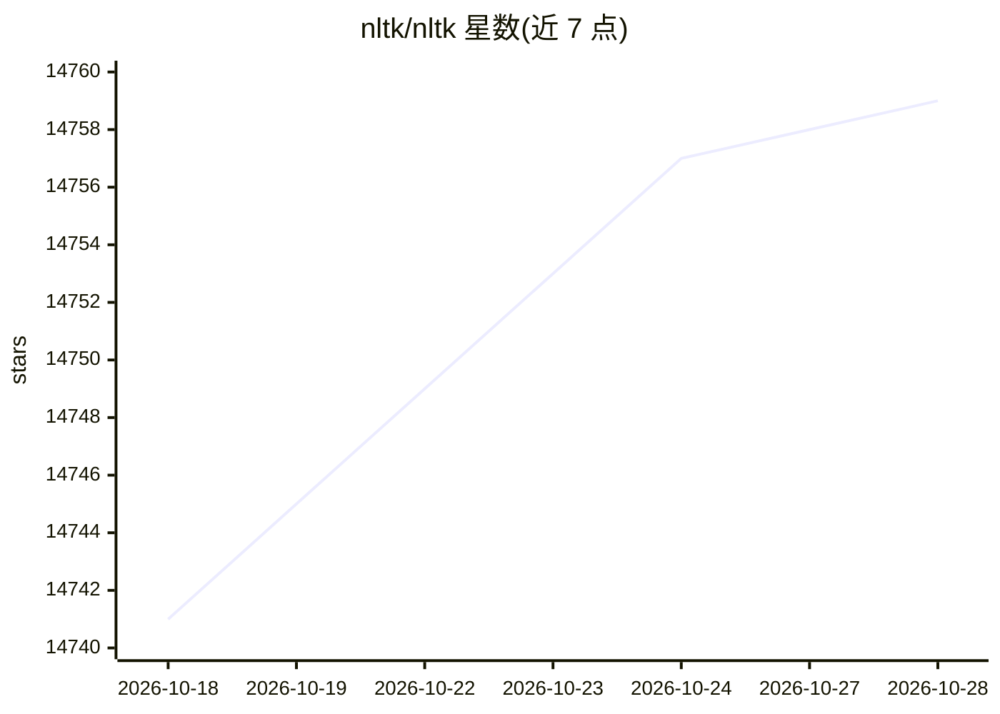

# nltk/nltk

⭐ 14,760 · Python · Apache-2.0 · 推送 2026-10-28 · [GitHub](https://github.com/nltk/nltk) · [官网](https://www.nltk.org) · 组织维护

**面向 NLP 研究与开发的 Python 模块、数据集与教程套件**

NLTK 是一套开源 Python 模块、数据集与教程，支持自然语言处理的研究与开发。要求 Python 3.10 至 3.14。文档托管于 nltk.org，贡献指南与引用条目（NLTK 书，O'Reilly 2009）在 README 中给出。源码采用 Apache 2.0 许可，文档采用 CC BY-NC-ND 3.0，语料库按各自 README 条款以非商业用途再分发。

## 筛选速览

| 维度 | 判定 | 备注 |
|---|---|---|
| AI 角色 | `ai-ecosystem` | LLM/agent 周边工具 |
| 许可风险 | `dual` | Apache-2.0 |
| 部署形态 | `library` | 以包/库形式分发 |
| 模型依赖 | — | README 未给出锁定关系 |
| 硬件要求 | — | 无带数字的原话,不猜 |
| 安装摩擦 | `low` | 无编译、无系统依赖或容器化 |
| 成熟度 | — | 结构信号不足 |

## 动量与使用信号

- 维护:`active` — 距上次 push 0.9 天,年发版 8,368 位贡献者
- 涨星:近 1 天 **+2**(自 20261016 起算)

## 能力要点

- 提供 Python 模块、数据集与教程的组合
- 要求 Python 3.10–3.14
- 源码 Apache 2.0，文档 CC BY-NC-ND 3.0，语料库可再分发

## 适用场景

- 开展自然语言处理的科研与教学
- 在 Python 项目中调用 NLP 模块与数据集

## 场景标签

`科研工具` `教程课程` · 领域:学习与行业

## 证据(README 行号)

> L5: NLTK -- the Natural Language Toolkit -- is a suite of open source Python
> L6: modules, data sets, and tutorials supporting research and development in Natural
> L7: Language Processing. NLTK requires Python version from 3.10 up to the latest 3.14.

## 星数曲线

2026-10-18 14,741 → 2026-10-28 14,759（+18）

---
*卡片 v1 · prompt 1.4 · 生成 2026-10-18 · 置信度 high · 依据 README sha `74bf2ded4b25` · [字段定义](../../DATASET.md)*
