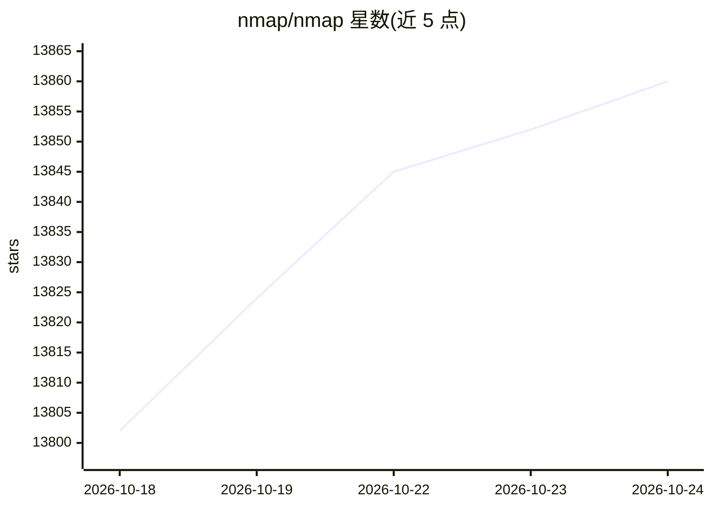

# nmap/nmap

⭐ 13,860 · C · NOASSERTION · 推送 2026-10-22 · [GitHub](https://github.com/nmap/nmap) · [官网](https://svn.nmap.org/) · 组织维护

**网络扫描与主机发现工具，供网络管理员使用**

GitHub 上的 Nmap 官方 SVN 镜像仓库。Nmap 是网络扫描工具（Network Mapper），提供主机发现、端口扫描等网络探测功能，并附带图形界面前端 Zenmap。README 说明安装方式为源码编译（configure/make/make install），Windows、macOS 与 Linux（RPM）的二进制安装包从 Nmap.org 获取，完整文档在 Nmap.org 网站。采用基于 GPLv2 但与其不兼容的自定义许可证，终端用户可免费使用，企业再分发需商业许可。

## 筛选速览

| 维度 | 判定 | 备注 |
|---|---|---|
| AI 角色 | `ai-enhanced` | 去掉 AI 部分产品仍成立 |
| 许可风险 | `dual` | NOASSERTION |
| 部署形态 | `None` |  |
| 模型依赖 | — | README 未给出锁定关系 |
| 硬件要求 | — | 无带数字的原话,不猜 |
| 安装摩擦 | `medium` | 含编译或系统依赖之一 |
| 成熟度 | — | 结构信号不足 |

## 动量与使用信号

- 维护:`active` — 距上次 push 2.4 天,年发版 0,4 位贡献者
- 涨星:近 1 天 **+21**(自 20261016 起算)
- 平台:WINDOWS / MACOS / LINUX · 协议:—

## 能力要点

- 提供源码编译安装（./configure && make && make install）
- Windows/macOS/Linux 提供 Nmap.org 官方二进制安装包
- 内置 Zenmap 图形界面前端
- 自定义许可证：终端用户免费，企业再分发需商业许可

## 适用场景

- 扫描网络中的主机与开放端口
- 使用 Zenmap 图形界面进行网络探测
- 从源码在 Linux 环境编译安装 Nmap

## 场景标签

`网络安全` · 领域:学习与行业

## 证据(README 行号)

> L19: Installing
> L30: Nmap has a lot of features, but getting started is as easy as running `nmap

## 星数曲线

2026-10-18 13,802 → 2026-10-24 13,860（+58）

---
*卡片 v1 · prompt 1.4 · 生成 2026-10-18 · 置信度 mid · 依据 README sha `120a36986826` · [字段定义](../../DATASET.md)*
