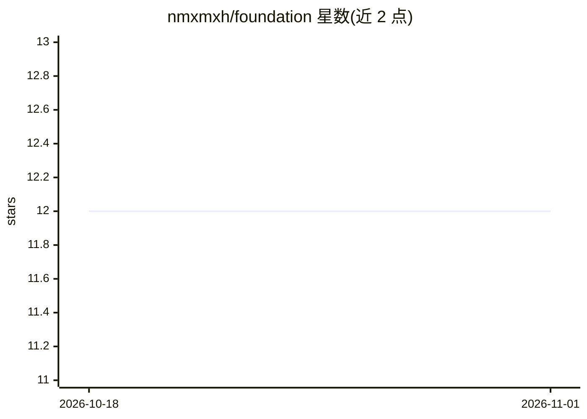

# nmxmxh/foundation

⭐ 12 · Go · NOASSERTION · 推送 2026-10-31 · [GitHub](https://github.com/nmxmxh/foundation) · 个人维护

**面向人机协作的全栈高性能开发基座（Go/Rust/TS）**

由个人维护的全栈开发框架（版本 0.0.1，自述 Work in Progress），组合 Go 后端（server-kit：事件总线、Hermes 读模型、worker、可观测性）、TypeScript 客户端传输层、Rust/WASM 运行时内核、React UI 组件与 Tauri 原生桥。核心机制是单一契约架构：用 Protobuf/Cap'n Proto 定义一次变更，生成 Go 路由、TS 类型与零拷贝二进制布局；提供七层性能阶梯与每层成本测量，以及 40+ 项提交时自动执行的强制检查（Practice Controls），供人和 AI agent 在严格契约下协作开发。脚手架工具一键生成预配置项目。仓库明确声明 agentic 编码模式仍在验证中。

## 筛选速览

| 维度 | 判定 | 备注 |
|---|---|---|
| AI 角色 | `ai-ecosystem` | LLM/agent 周边工具 |
| 许可风险 | `none` | NOASSERTION |
| 部署形态 | `None` |  |
| 模型依赖 | — | README 未给出锁定关系 |
| 硬件要求 | — | 无带数字的原话,不猜 |
| 安装摩擦 | `low` | 无编译、无系统依赖或容器化 |
| 成熟度 | `idea` | |

## 能力要点

- 单一契约架构：Protobuf/Cap'n Proto 一次定义，生成 Go/TS 代码与零拷贝布局
- 七层性能阶梯，每层成本测量并在 CI 中自动捕获回归
- 40+ 项提交级强制检查（Practice Controls、契约漂移、并发安全）
- 脚手架工具 init/update 秒级生成预配置项目并与核心模块同步

## 适用场景

- 生成预配置 PostgreSQL/Redis/Go-React-Rust 全栈项目
- 让 AI agent 在严格契约与机器可判定的检查门下协作写代码
- 构建对延迟敏感的实时全栈应用并按性能阶梯选择执行层

## 场景标签

`代码生成` · 领域:编码与开发

## 证据(README 行号)

> L11: Foundation concentrates systems complexity into infrastructure. A person or
> L115: - **Deterministic AI Context**: Agents get strict `.cursorrules` / `.clauderules`, a clear `AGENTS.md` operating c
> L171: This repository is designed for agent-assisted development. While I review and sign off on all modifications, many

## 星数曲线

2026-10-18 12 → 2026-11-01 12（+0）

---
*卡片 v1 · prompt 1.4 · 生成 2026-11-01 · 置信度 high · 依据 README sha `5b789b64a58c` · [字段定义](../../DATASET.md)*
